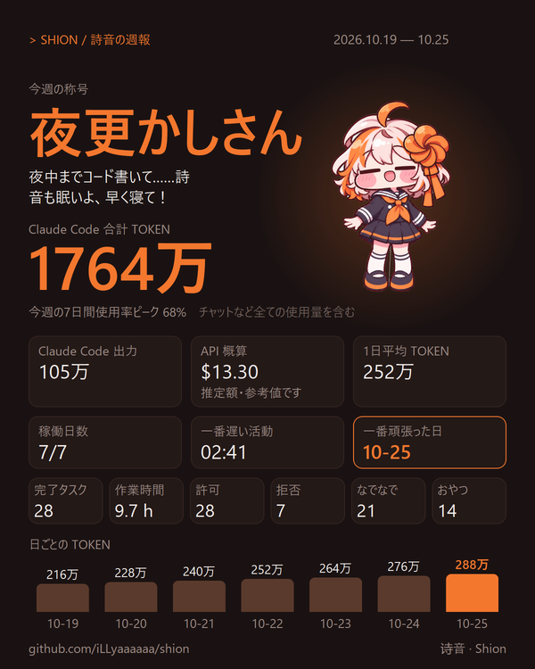
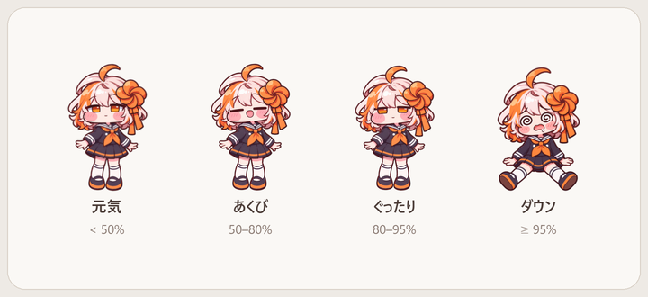
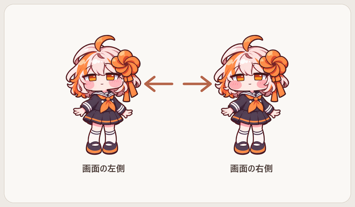
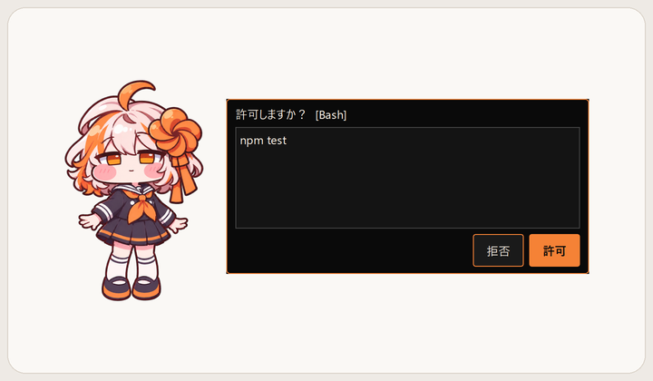
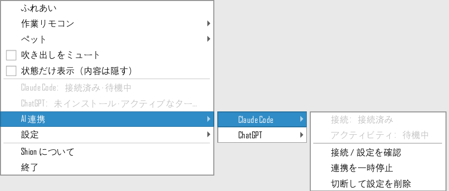
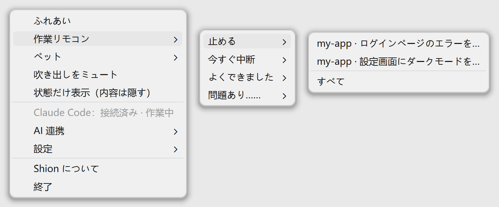

<div align="center">

# Shion · 詩音

**Claude Code と連動し、ChatGPT（Codex）の作業も見守るデスクトップマスコット**


[English](README.md) · [中文](README.zh.md) · 日本語

</div>

> [!NOTE]
> **非公式プロジェクトです。** Shion は個人制作のオープンソース作品で、Anthropic とは一切関係がなく、承認・後援・提携も受けていません。「Claude」「Claude Code」は Anthropic の、「ChatGPT」「Codex」は OpenAI の商標であり、互換性の説明のためにのみ使用しています。OpenAI とも一切関係はありません。

---

## 詩音について

詩音はあなたのデスクトップに住む小さな女の子です。まばたきしたり、呼吸したり、ぼーっとしたり、ときどき独り言を言ったりします。紙人形のような立ち絵で、髪もゆらゆら揺れます。
Claude Code や Claude デスクトップ版のチャット（または ChatGPT の Codex）で作業しているときは**そばで見守ってくれます**。作業が始まると真剣な顔になり、終わったら知らせてくれて、確認が必要なときはパネルを出して聞いてくれます。

コードを読んだり、ネットに接続したり、あなたの代わりに AI と会話したりはしません。ただ、そばにいてくれるだけです。

## 機能

### Claude Code との連動
- **状態の把握**：作業中・完了・エラー・確認待ちに合わせて表情が変わり、声をかけてくれます
- **許可リクエストへの応答**：Claude Code がコマンド実行やファイル編集を求めると、詩音が「許可 / 拒否」パネルを出します（Claude Code 側で答えても OK。先に答えた方が有効です。**勝手に許可することは絶対にありません**）
- **許可する前に内容を確認**：パネルには操作のわかりやすい要約が表示されます。Bash と PowerShell は常にコマンド全文が表示され、長い場合はスクロールできます。判別できる操作は短く説明し、Claude が添えた説明には出どころを明記します。よくある危険な操作には赤い警告が出ます。「詳細」では元のツール名とフックから受け取った情報を確認できます。
- **止める / 続ける**：次のツールのチェックポイントで止まり、頭上に「一時停止中」を表示。クリックで続行
- **今すぐ中断**：実行中のツールプロセスを止め、次のチェックポイントでターンを終了します。出力中の文章は、今の一文が終わるまで続くことがあります。作業プロセスが見つからない場合は、次のチェックポイントで一時停止します
- **よくできました / 問題あり……**：あなたの評価を作業中の AI にそっと伝えます（コンテキストとして追加されるだけで、会話にメッセージは増えません）
- **プランと完了のお知らせ**：元のセッションでプランや応答を確認するよう知らせます
- **複数セッションの同時作業**：Claude Code のセッションが複数動いているときは、「作業リモコン」の止める・今すぐ中断・よくできました・問題あり……がサブメニューになり、1 つのセッション（または「すべて」）を選べます。セッションはプロジェクトフォルダー名で区別し、同じプロジェクトで 2 つ開いているときは最初の発言の冒頭数文字も表示します
- **連携を一時停止**：右クリック →「AI 連携」→「Claude Code」→「連携を一時停止」。停止中はパネルを出さず、許可は Claude Code 側に任せます。いつでも再開できます
- **詩音が起動していなくても Claude Code が遅くならない**：hook は詩音がいないとすぐに Claude Code へ処理を返し、待ちません

### Claude デスクトップ版のチャット連動
- **チャットの状態のお知らせ**：接続すると、ツールを使う作業や時間のかかる作業をチャットで始めたとき、返事が必要なとき、終わったときに Claude が詩音に知らせます。詩音は真剣な顔になったり、声をかけたり、見に行くよう教えてくれます（セリフは毎回変わります）
- **観測のみ**：詩音からチャットを一時停止・中断することはできません。チャットだけが作業中のときは「作業リモコン」全体がグレーになるので、Claude 側で停止をクリックしてください。チャットと Claude Code が同時に作業しているときは、「止める」は Claude Code だけを止め、詩音は「作業中」の表示を続けます
- **個人設定で呼び出し**：いつ知らせるかは Claude が決めます。詩音が用意した一文を Claude の個人設定に貼り付けてください（下の「Claude デスクトップ版チャットとの接続」を参照）

### ChatGPT（Codex）の観測
- Codex CLI と Codex デスクトップアプリに対応：作業の開始、ツールの実行、許可待ち、完了に合わせて表情が変わり、声をかけてくれます
- **観測のみ**：Codex の許可・停止・中断を代わりに行うことはできません。確認が必要なときは、Codex 側を見に行くよう知らせるだけです
- Claude Code とは別に管理：右クリック →「AI 連携」→「ChatGPT」でインストール・一時停止・削除できます

### タスクラベル

- 詩音のそばに、Claude Code、Claude デスクトップ版のチャット、ChatGPT（Codex）のタスクが並びます。黄色は待機中、青い点は作業中、緑のチェックは完了です。Claude Code の作業中ラベルには、情報がある場合に現在の操作やタスクの短い要約が表示されます。マウスを重ねると、セッション名と詳細が見られます。
- 完了したラベルはクリックで消せます。「すべて消去」が表示されていれば一括で消せます。**+N** をクリックすると残りが表示されます。Claude Code の許可待ちやチェックポイントのラベルをクリックすると該当パネルが手前に出ます。プランの確認待ちラベルもクリックで消せます。
- 右クリック →「設定」→「タスクラベルを表示」で表示を切り替えられます。「状態だけ表示（内容は隠す）」を選ぶと、タスクの内容が隠れます。

<p align="center"><br>タスクラベル（サンプルデータ）。</p>

### Claude Code のトークン予算

- Claude Code のタスクラベルを右クリックすると、そのセッションの予算を設定できます。「設定」では「新規セッションの既定予算」と「CC の1日合計」を変更できます。初期値はどちらも無制限で、候補から選ぶことも、任意の値を入力することもできます。
- Claude Code の入力、出力、キャッシュの書き込みと読み込み、サブエージェントの使用量をトークンで数えます。Claude のチャットは集計対象外です。セッション予算は会話の最初から、1日合計は現地時刻の午前0時から数えます。1日合計の反映は実際より約1分遅れることがあります。
- 次のチェックポイントで一時停止するため、上限を少し超える場合があります。両方の上限に達したときは1日合計が優先されます。パネルでは今日の上限を引き上げるか、「今日だけ無制限」を選ぶか、1日合計で停止したターンをすべて終了できます。
- 「使用量を集計」をオフにすると、予算の設定がグレーになり、予算による一時停止と通知が無効になります。

### 通知領域のアイコン

- Windows の通知領域にある詩音のアイコンをクリックすると詩音を呼び戻せます。右クリックでメニューを開けます。マウスを重ねると、今日の Claude Code の使用量と上限が表示されます。

### 詩音の週報
- 右クリック →「詩音の週報」。最初は先週の分が開き、ウィンドウで「今週」に切り替えられます。毎週月曜の最初の起動時には、詩音がレポートを持って知らせてくれます
- カードには今週の称号、Claude Code の合計トークンと出力トークン、日ごとのトークンのグラフ、活動日数、いちばん遅い活動時刻、そして詩音が自分で数えた完了タスク・作業時間・許可 / 拒否・なでた回数・おやつの回数が載ります
- **API 料金の目安**：Anthropic が公開している標準 API 料金で計算した見積もりです（料金表の日付 2026-11-02）。参考用で、サブスクリプションの実際の請求とは関係ありません
- 7 日間の使用率を受け取っていれば、今週の最大値も表示します（この割合はチャットなど全ての使用量を含みます）
- 「画像を保存」「クリップボードにコピー」ができます。右クリック →「設定」で「使用量を集計」や「週報にプロジェクトリンクを表示」をオフにできます
- **トークンは Claude Code の分だけ**：ローカルにある Claude Code の会話記録から数えます。claude.ai やデスクトップアプリでの通常のチャットは含みません

<p align="center"><br>週報カード（合成データ）。</p>

### 体力
- Claude Code の **5 時間の使用率** で 4 段階：50% 未満は元気、50–80% はあくび、80–95% はぐったり、95% 以上はダウン（倒れ込んだ専用ポーズ）。段階が変わるとひと言しゃべり、使用率がリセットされると完全復活してジャンプします
- **4 段階はターミナル版の Claude Code だけ**：statusLine に渡される `rate_limits` を使います（Pro / Max プラン、セッションの最初の返信以降）
- **Claude デスクトップアプリの Code** は statusLine を実行しないため、2 段階だけです：上限に達するとダウン（`StopFailure` hook）、自動再開されると復活
- 詩音をダブルクリックすると「5時間の使用率」（有効な最新データのみ）と「7日間の使用率」（最後に受け取った値。古いときは「73%（3 時間前）」のように表示）が見られます
- 使用率が分からないときは推測せず、**トークンから計算することもしません**：モデルごとの重みや上限は公開されておらず、通常のチャットの使用量もローカルでは見えないため、計算値は誤解を招きます
- 体力は待機中の見た目を変えるだけです。許可パネルや停止 / 再開などの操作がいつも優先されます

<p align="center"></p>

### ふだんのふれあい
- なでなで（ハートが出ます）、頭をコツン（星が出て、続けると抗議します）、つつく、おなかをくすぐる
- **ほっぺをつまむ**：ほっぺをつまんで左右に引っぱり、離すとぷくっと膨らんで戻ります。短時間に何度もつまむとすねます。**ほっぺをつまんだまま上に持ち上げると、持ち上げて移動できます**（体をドラッグしても動きません）。離した場所にとどまり、勢いよく放るかタスクバーに落とすと落下し、振ると目を回します。初回起動の約 10 秒後に一度だけヒントが出ます
- 画面のどちら側にいるかで、ほっぺは反対側に膨らみます。画面のもう半分に置くと、まばたきして向きが入れ替わります
- 作業中はノートパソコンを抱え、ときどきうなずきます
- 「お話 → おやつをあげる」、または用意された会話を選んで少しおしゃべり（AI モデルは使いません）
- 「動作」メニュー：ジャンプ、ベッドで寝る、ちょっと伏せる
- 時間帯に合わせたあいさつ：朝は朝ごはんのこと、深夜は「早く寝て」
- **好感度**：なでなで・おやつ・会話で少しずつ上がり、5 段階のレベルで新しい会話・おやつ・セリフが解放されます
- 中文 / English / 日本語

<table>
  <tr>
    <td align="center"><br>ほっぺをつまんで左右に引っぱる。離すとぷくっと膨らんで戻ります。</td>
    <td align="center"><br>ほっぺをつまんで上に引っぱると、持ち上げて運べます。</td>
  </tr>
</table>

<p align="center"><br>作業中はノートパソコンを抱えます。</p>

<p align="center"><br>画面のどちら側にいるかで、ほっぺは反対側に膨らみます。</p>

### じゃまをしない
- 透明な部分はクリックが下のウィンドウに届きます
- パネルは**表示時にキーボードのフォーカスを取りません**。会話ウィンドウをクリックすると数字キーで選べ、フィードバック入力欄をクリックすると入力できます
- 「最前面に表示」はオフにできます。Claude デスクトップアプリや Codex デスクトップアプリのウィンドウが前面に戻ると、詩音はそのすぐ上に表示されます
- 吹き出しのミュート、「状態だけ表示（内容は隠す）」、4 段階のサイズ、活発さの調整

<table>
  <tr>
    <td align="center"><br>なでなですると小さなハート。</td>
    <td align="center"><br>「ちょっと伏せる」でひと休み。</td>
  </tr>
  <tr>
    <td align="center"><br>リクエストに「許可 / 拒否」で応答。</td>
    <td align="center"><br>「ベッドで寝る」でおやすみ。</td>
  </tr>
  <tr>
    <td align="center"><br>「AI 連携」で Claude Code と ChatGPT を別々に管理。</td>
    <td align="center"><br>複数セッションでは 1 つだけ止められます。</td>
  </tr>
</table>

## 動作環境

- Windows 10 / 11（macOS / Linux は未対応）
- ダウンロードは約 75 MB（展開後は約 170 MB）。メモリ使用量は 2.x より多く、標準サイズで実測約 225 MB、大きいサイズではさらに増えます
- [Claude Code](https://docs.claude.com/en/docs/claude-code)（CLI 版、またはデスクトップアプリの Code）、Claude デスクトップ版（チャット連動）、または Codex（CLI 版、またはデスクトップアプリ）。どれとも連携しなくても普通のマスコットとして使えます

## インストール

1. [Releases](../../releases) から `Shion-3.2.0-win64.zip` をダウンロード
2. **固定の場所**に展開します（例：`D:\Apps\Shion`）。あとで移動した場合は再接続してください：Claude Code は右クリック →「AI 連携」→「Claude Code」→「接続 / 設定を確認」、Claude デスクトップ版チャットは一度切断してから接続し直します
3. `Shion.exe` をダブルクリック
4. 初回起動時に Claude Code と接続するか聞かれるので、**接続** を押します

Python のインストールは不要です。

**旧バージョンからの更新**：セーブデータ・好感度・設定はそのまま引き継がれます。元のフォルダーに**上書き展開**すれば、Claude Code も Claude デスクトップ版チャットも再接続は不要です。**新しいフォルダー**に展開した場合は、どちらも詩音から再接続してください（Claude デスクトップ版チャットは一度切断してから接続し直します。下記参照）。新しい版の接続が正常なことを確認したら、古いフォルダーは削除して構いません。

> [!TIP]
> 「Windows によって PC が保護されました」と表示されたら、**詳細情報 → 実行** を押してください。コード署名のないアプリでは、この警告が表示されることがあります。

## Claude Code との接続

「接続」を押すと、詩音の hooks が**ユーザー単位**の設定 `%USERPROFILE%\.claude\settings.json` に追加され、どのフォルダーで Claude Code を開いても連動します。

- 変更前に元のファイルを自動でバックアップします（`settings.json.shion-backup-日時`）
- 追加・削除するのは詩音自身の項目だけで、ほかの設定はそのまま残ります
- 設定ファイルの形式がおかしい場合は書き込みを中止し、ファイルを壊しません
- いつでも **右クリック →「AI 連携」→「Claude Code」→「切断して設定を削除」** できます。少し止めたいだけなら「連携を一時停止」を選んでください
- 以前のソースプロジェクトに詩音のプロジェクト単位の hooks がある場合は、そこで `tools\uninstall_hooks.py` を実行してから exe で接続してください。exe では古いプロジェクトの hooks を移行できません
- 接続時には `statusLine` も引き継ぎます（体力用）。もともとステータスラインのコマンドがあれば、同じ入力でそのまま実行して出力もそのまま表示します。切断するともとの設定に戻します

接続後に**新しく開いた** Claude Code のセッションから有効になります。

## Claude デスクトップ版チャットとの接続

右クリック →「AI 連携」→「Claude デスクトップ版」→「チャットを接続」：

1. Claude の開発者設定で「設定を編集」を選び、どの設定ファイルが開いたかを確認します
2. トレイから Claude を**完全に終了**します（ウィンドウを閉じるだけでは不十分です）
3. 詩音が開くダイアログでそのファイルを選びます。よくある場所を候補として示しますが、実際に使われるのは「設定を編集」で開いたファイルです
4. Claude を再起動し、クライアントのツール一覧に `shion_working`、`shion_done`、`shion_need_input` があることを確認します。詩音が MCP のオンライン通知を受け取って初めて接続が成立します。設定の書き込みだけでは接続できたことになりません
5. 「個人設定の文をコピー」を選び、Claude の個人設定に貼り付けます。コピーされるのは次の文です：

   > ツールを使う作業や時間のかかる作業では、開始前に shion_working を、終了後に shion_done を呼んでください。簡単な質問では呼ばなくて大丈夫です。

- 書き込む前にローカルにバックアップを保存し、詩音自身の MCP 項目だけを追加します。同名の項目、壊れたファイル、重複したキー、書き込み中の変更を見つけると、書き込まずに止まります
- **切断**：Claude を完全に終了してから「チャットを切断」を選び、そのあと Claude を再起動します。ほかに変更がなければ元のファイルをバイト単位で戻し、変更があれば詩音が登録した未変更の項目だけを削除して、ほかの追加設定は残します
- 設定ファイルが削除・破損していたり、shion 項目が変更されていたりすると、詩音が「接続記録を消去」するか聞きます。詩音側の記録だけを消し、設定には触れません。そのあと設定ファイルを開き、shion 項目が残っていないか確認してください

## ChatGPT（Codex）との接続

ChatGPT との連携は別にインストールします：右クリック →「AI 連携」→「ChatGPT」→「接続 / 設定を確認」。

- Codex の設定（既定では `%USERPROFILE%\.codex` の `config.toml` と `hooks.json`）への変更内容を先に表示し、確認してから書き込みます。追加するのは詩音自身の項目だけで、設定のコピーは保存しません。切断時は記録どおりにその項目だけを削除し、内容が変わっていて一致しない場合は上書きせずに止まります
- インストール後、Codex の `/hooks` で詩音の各 Hook を確認し、`/mcp` で接続を確認してください。初回は Codex を再起動してから、会話を新規作成または開き直してください
- 同じサブメニューから「連携を一時停止」「切断して設定を削除」ができます

## 使い方

| 操作 | 効果 |
|---|---|
| 左クリック | つつく |
| 頭の上で左ボタンを押したまま左右に動かす | なでなで |
| 頭の上をクリック | 頭をコツン（星が出て、続けると抗議します） |
| ほっぺをつまんで左右に引っぱる | ほっぺをつまむ。離すとぷくっと膨らんで戻ります |
| ほっぺをつまんで上に持ち上げる | 持ち上げる。離した場所にとどまります。勢いよく放るかタスクバーに落とすと落下し、振ると目を回します。**移動できるのはこの方法だけで、体をドラッグしても動きません**（初回起動の約 10 秒後に一度だけヒントが出ます） |
| おなかの上で左右にこする | くすぐる（おなかを 1 回クリックするだけならつつく動作） |
| ダブルクリック | 状態を表示（一緒にいる時間、好感度レベル、接続状態、使用率） |
| 右クリック | メニュー：ふれあい、作業リモコン、ペット（表情、動作、サイズなど）、AI 連携、設定（言語、スタートアップで起動）など |

## プライバシー

- すべてあなたの PC 内で完結します。ローカルサーバーは `127.0.0.1` だけで待ち受け、Web ページからのリクエストは拒否します
- **外部ネット接続なし・データ送信なし・AI モデルの呼び出しなし**。hooks の通信はローカルホスト内のみです
- 詩音は hooks のイベントを受け取り、許可パネルには操作の詳細を表示します。通常の作業表示は短い要約で、ファイル名などの詳細がローカルログに残ることがあります。コードファイルや会話本文は保存しません
- 「状態だけ表示（内容は隠す）」では作業の詳細を隠し、それ以降のイベントログにも詳細を含めません。既存ログは残ります。許可パネルには確認が必要な操作を引き続き表示します
- hook と詩音のあいだは一度きりのトークンで認証し（詩音を起動するたびに新しくなります）、ローカルポートは排他的に使うため、PC 上のほかのプログラムが詩音や hook になりすますのを防ぎます
- 同じプロジェクトで Claude Code のセッションを複数開いているときは、各セッションの最初の発言の冒頭数文字をメニューでの区別のためだけにメモリに保持します。ログにもセーブデータにも書かず、終了すると消えます。「状態だけ表示（内容は隠す）」がオンのときは、hook はそもそも送りません
- **Claude デスクトップ版のチャット**：詩音が受け取るのは、Claude がどのツールを呼んだか（開始 / 返事が必要 / 完了）と、Claude が付ける最大 20 文字の作業名だけで、**会話の内容は受け取りません**。作業名は吹き出しに出るだけでログには書かず、「状態だけ表示（内容は隠す）」がオンのときは表示しません。接続時のバックアップ `%APPDATA%\Shion\desktop-chat-backup.json` には元の設定全体（ほかの MCP サーバーの環境変数を含むことがあります）が入っており、切断に成功したときか接続記録を消去したときに削除します
- ChatGPT（Codex）の観測も PC 内だけで行い、詩音が Codex を操作することはありません
- **週報の使用量集計** は、ローカルにある Claude Code の会話記録（`%USERPROFILE%\.claude\projects` 内の `.jsonl`）から `usage` フィールド・モデル名・時刻だけを読み、**会話の内容は読みません**。保存するのは日ごとの合計だけで、`%APPDATA%\Shion\usage.json` に 8 週間分残します。「設定」の「使用量を集計」でオフにできます
- **statusLine**：詩音が受け取るのは 5 時間 / 7 日間の使用率とリセット時刻（とセッション ID）だけで、ローカルアドレスに送ります。ほかのフィールドは転送しません。接続時に `statusLine` を引き継ぎ、もとのコマンドを連結して実行します。もとのコマンドの直近の成功出力は `%APPDATA%\Shion\statusline-last.bin` にキャッシュし、タイムアウト時に代わりに表示します。切断するともとの値に戻し、キャッシュと記録ファイルを削除します
- セーブデータとログは `%APPDATA%\Shion` にあります

## よくある質問

**詩音が反応しない**
ダブルクリックして接続状態を確認してください。「パスが無効、または設定が不完全」と出たら、アプリの場所を確認して右クリック →「AI 連携」→「Claude Code」→「接続 / 設定を確認」で再接続してください。そのあと**新しい** Claude Code セッションを開いてください。

**Codex を使うとき、詩音が自動で起動しない**
Claude Code は新しいセッションを開くと詩音を起動してくれますが、Codex ではしません。Codex を使う場合は、右クリック →「設定」→「スタートアップで起動」をオンにしておくと、パソコンを起動したときから詩音がいます。

**ChatGPT（Codex）が作業を始めたのに詩音が反応しない**
Codex デスクトップアプリは「作業開始」のイベントを送らないため、最初にツールを呼び出してから「作業中」になります。ずっと反応しない場合は、Codex の `/hooks` で詩音の Hook が承認されているか確認し、Codex を再起動してください。

**Claude デスクトップ版のチャットで作業しているのに詩音が反応しない**
接続後に Claude を完全に終了して再起動したか、クライアントのツール一覧に `shion_working` などの 3 つのツールがあるか、個人設定に詩音の文を貼り付けたかを確認してください。いつ知らせるかは Claude が決めるため、ときどき抜けることがあります。簡単な質問ではもともと知らせません。

**「ポートが使用中」と出る**
詩音はローカルポート `47613` を使います。詩音を 2 つ同時に起動していないか確認してください。

**ウイルス対策ソフトに検出される**
PyInstaller でパッケージしたアプリはまれに誤検出されます。ソースを確認して自分でビルドする（下記参照）か、フォルダーを除外リストに追加してください。

**アンインストール方法**
1. 右クリック →「AI 連携」→「Claude Code」→ **切断して設定を削除**（Claude Code の設定から詩音の hooks を削除し、もとの statusLine に戻します）。ChatGPT 連携を入れた場合は「ChatGPT」でも同じ操作をします。Claude デスクトップ版のチャットを接続した場合は、Claude を完全に終了してから「Claude デスクトップ版」の「チャットを切断」を選びます
2. 右クリック → 「スタートアップで起動」をオフ（オンにしている場合）
3. 右クリック →「終了」で閉じてから、アプリのフォルダーと `%APPDATA%\Shion`（セーブデータとログ）を削除

## 既知の制限

- メモリ使用量は 2.x より多くなります（標準サイズで実測約 225 MB、大きいサイズではさらに増えます）
- ベッドで寝る・机に伏せる・ぐったり倒れる（体力ダウン）の姿勢では、ほっぺをつまむ・くすぐるは反応しません（なでなで・頭をコツンは可）。ほっぺ以外をドラッグしても動かず、「ほっぺをつまんで上に持ち上げて」というヒントが出るだけです
- 体力の 4 段階（5 時間の使用率）はターミナル版の Claude Code だけです。デスクトップアプリは hook による 2 段階（上限でダウン、自動再開で復活）で、7 日間の使用率はターミナルから最後に受け取った値しか表示できません。デスクトップ版のダウン / 復活は実際に上限に達したときの検証がまだです
- 週報のトークンは Claude Code の分だけで、通常のチャットは含みません。API 料金は参考用の見積もりです
- もとのステータスラインのコマンドは 1 回あたり最大 1 秒待ちます。タイムアウトしたときは前回の出力を表示します。Git Bash がない場合は PowerShell 経由で実行され、起動に 1 秒以上かかることがあるため、最初の更新でもとのステータスラインの出力が表示されないことがあります
- Claude デスクトップ版のチャット連動は、ローカルの Claude デスクトップ版だけに対応します。呼び出しは Claude が自分で行うため、抜けることがあります。15 分間続きの通知がなければ、静かに待機に戻ります。接続・切断の前には Claude を完全に終了してください。詩音は Claude が起動中かどうかを確認しないため、起動中の Claude がメモリ上の古い設定で書き込みを上書きすることがあります
- チャットのトークンはローカルで集計できず、週報にも含まれません
- ChatGPT（Codex）と Claude デスクトップ版のチャットは観測のみです。許可・停止・中断はできず、「作業リモコン」は Claude Code にだけ効きます
- Codex デスクトップアプリは「開始」イベントを送らないため、最初のツール呼び出しまで「作業中」になりません
- Codex は詩音を自動で起動しません（上のよくある質問を参照。「スタートアップで起動」をおすすめします）
- Codex デスクトップアプリでの実機検証はまだ限られており、状態がずれることがあります

## ソースから実行

```bat
git clone https://github.com/iLLyaaaaaa/shion.git
cd shion
python -m venv .venv
.venv\Scripts\pip install -r requirements.txt
start.bat
```

Python 3.10 以上が必要です。キャラクター画像は生成済みです（`tools/v3_*.py` で生成。元画像 `assets/sprites/raw` は非公開）。通常のユーザーはこれらのスクリプトを実行する必要はありません。ビルド：`.venv\Scripts\python tools\build.py`（出力先 `dist\Shion\`）。テスト：`.venv\Scripts\python -m pytest -q`。

## ライセンス

このプロジェクトは 2 つのライセンスに分かれています。

| 内容 | ライセンス | できること |
|---|---|---|
| コードとその他の内容（詩音のキャラクター画像を除く。セリフとメニューデータを含む） | [MIT](LICENSE) | 著作権表示とライセンス表示を残せば、商用を含めほぼ自由に使えます |
| 詩音のキャラクター画像（現在は `assets/sprites/`、`assets/weekly/`、`docs/images/`、`assets/icon/` を含む） | [CC BY-NC 4.0](assets/LICENSE) | 作者表記・ライセンスリンク・変更表示のうえ共有・改変可、**商用利用は不可** |

詩音が使うサードパーティライブラリ（tomlkit、NumPy、SciPy、Pillow）のライセンスは[サードパーティのライセンス](THIRD_PARTY_NOTICES.md)を参照してください。

Shion / 诗音（詩音）は iLLyaaaaaa のオリジナルキャラクターです。詩音のキャラクター画像は CC BY-NC 4.0 です。現在は `assets/sprites/`、`assets/weekly/`（週報カードの立ち絵）、`docs/images/`（スクリーンショット、`hero.gif`、アイコンプレビュー）、`assets/icon/` を含み、今後追加する詩音のキャラクターアイコン（`.ico` / `.png`）にも適用されます。セリフやメニューデータなど、その他の内容はコードと同じ MIT です。コードから自分のマスコットを作れますが、詩音の画像は非商用に限ります。

## クレジット

- キャラクターデザイン・アート：[iLLyaaaaaa](https://github.com/iLLyaaaaaa)（オリジナルキャラクター、AI 画像ツールを使って制作）
- 開発には AI コーディングツールを利用しました

---

<div align="center">
<sub>Shion は非公式の個人作品であり、Anthropic・OpenAI とは関係ありません。</sub>
</div>
