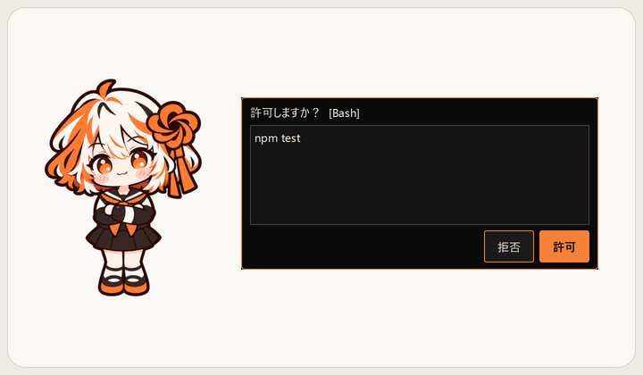

<div align="center">

# Shion · 詩音

**Claude Code と連動するデスクトップマスコット**


[English](README.md) · [中文](README.zh.md) · 日本語

</div>

> [!NOTE]
> **非公式プロジェクトです。** Shion は個人制作のオープンソース作品で、Anthropic とは一切関係がなく、承認・後援・提携も受けていません。「Claude」「Claude Code」は Anthropic の商標であり、互換性の説明のためにのみ使用しています。

---

## 詩音について

詩音はあなたのデスクトップに住む小さな女の子です。まばたきしたり、呼吸したり、ぼーっとしたり、ときどき独り言を言ったりします。
Claude Code で作業しているときは**そばで見守ってくれます**。作業が始まると真剣な顔になり、終わったら知らせてくれて、確認が必要なときは目の前まで持ってきてくれます。

コードを読んだり、ネットに接続したり、あなたの代わりに AI と会話したりはしません。ただ、そばにいてくれるだけです。

## 機能

### Claude Code との連動
- **状態の把握**：作業中・完了・エラー・確認待ちに合わせて表情が変わり、声をかけてくれます
- **許可リクエストへの応答**：Claude Code がコマンド実行やファイル編集を求めると、詩音が「許可 / 拒否」パネルを出します（Claude Code 側で答えても OK。先に答えた方が有効です。**勝手に許可することは絶対にありません**）
- **止める / 続ける**：次のツールのチェックポイントで止まり、頭上に「一時停止中」を表示。クリックで続行
- **今すぐ中断**：実行中のツールプロセスを止め、次のチェックポイントでターンを終了します。出力中の文章は、今の一文が終わるまで続くことがあります。作業プロセスが見つからない場合は、次のチェックポイントで一時停止します
- **よくできました / 問題あり……**：あなたの評価を作業中の AI にそっと伝えます（コンテキストとして追加されるだけで、会話にメッセージは増えません）
- **計画・完了のお知らせ**：見に行くよう知らせるだけで、内容はデスクトップに表示しません

### ふだんのふれあい
- なでなで（ハートが出ます）、つつく、ほっぺをつまむ、くすぐる、持ち上げて振る（目を回します）
- 「お話 → おやつをあげる」、または用意された会話を選んで少しおしゃべり（AI モデルは使いません）
- 「動作」メニュー：ジャンプ、振り向く、ベッドで寝る、ちょっと伏せる
- 時間帯に合わせたあいさつ：朝は朝ごはんのこと、深夜は「早く寝て」
- **好感度**：なでなで・おやつ・会話で少しずつ上がり、5 段階のレベルで新しい会話・おやつ・セリフが解放されます
- 中文 / English / 日本語

### じゃまをしない
- 透明な部分はクリックが下のウィンドウに届きます
- パネルは**表示時にキーボードのフォーカスを取りません**。会話ウィンドウをクリックすると数字キーで選べ、フィードバック入力欄をクリックすると入力できます
- 「最前面に表示」はオフにできます。Claude デスクトップアプリのウィンドウが前面に戻ると、詩音はそのすぐ上に表示されます
- 吹き出しのミュート、「状態だけ表示（内容は隠す）」、4 段階のサイズ、活発さの調整

<table>
  <tr>
    <td align="center"><br>なでなですると小さなハート。</td>
    <td align="center"><br>「ちょっと伏せる」でひと休み。</td>
  </tr>
  <tr>
    <td align="center"><br>リクエストに「許可 / 拒否」で応答。</td>
    <td align="center"><br>「ベッドで寝る」でおやすみ。</td>
  </tr>
</table>

## 動作環境

- Windows 10 / 11（macOS / Linux は未対応）
- [Claude Code](https://docs.claude.com/en/docs/claude-code)（CLI 版、またはデスクトップアプリの Code）。連携しなくても普通のマスコットとして使えます

## インストール

1. [Releases](../../releases) から `Shion-1.0.0-win64.zip` をダウンロード
2. **固定の場所**に展開します（例：`D:\Apps\Shion`）。あとで移動した場合は右クリック →「Claude Code に再接続」を選んでください
3. `Shion.exe` をダブルクリック
4. 初回起動時に Claude Code と接続するか聞かれるので、**接続** を押します

Python のインストールは不要です。

> [!TIP]
> 「Windows によって PC が保護されました」と表示されたら、**詳細情報 → 実行** を押してください。コード署名のないアプリでは、この警告が表示されることがあります。

## Claude Code との接続

「接続」を押すと、詩音の hooks が**ユーザー単位**の設定 `%USERPROFILE%\.claude\settings.json` に追加され、どのフォルダで Claude Code を開いても連動します。

- 変更前に元のファイルを自動でバックアップします（`settings.json.shion-backup-日時`）
- 追加・削除するのは詩音自身の項目だけで、ほかの設定はそのまま残ります
- 設定ファイルの形式がおかしい場合は書き込みを中止し、ファイルを壊しません
- いつでも **右クリック → 接続を解除** できます
- 以前のソースプロジェクトに詩音のプロジェクト単位の hooks がある場合は、そこで `tools\uninstall_hooks.py` を実行してから exe で接続してください。exe では古いプロジェクトの hooks を移行できません

接続後に**新しく開いた** Claude Code のセッションから有効になります。

## 使い方

| 操作 | 効果 |
|---|---|
| 左クリック | つつく |
| 頭の上で左ボタンを押したまま左右に動かす | なでなで |
| ほっぺを横に引っぱる | ほっぺをつまむ |
| おなかを 3 回クリック / 押したまま左右にこする | くすぐる |
| ドラッグ | 持ち上げる。離した場所にとどまります。強く振ると目を回します |
| ダブルクリック | 状態を表示（一緒にいる時間、好感度レベル、接続状態） |
| 右クリック | メニュー：お話、作業リモコン、表情、動作、サイズ、言語、スタートアップで起動など |

## プライバシー

- すべてあなたの PC 内で完結します。ローカルサーバーは `127.0.0.1` だけで待ち受け、Web ページからのリクエストは拒否します
- **外部ネット接続なし・データ送信なし・AI モデルの呼び出しなし**。hooks の通信はローカルホスト内のみです
- 詩音は hooks のイベントを受け取り、許可パネルには操作の詳細を表示します。通常の作業表示は短い要約で、ファイル名などの詳細がローカルログに残ることがあります。コードファイルや会話本文は保存しません
- 「状態だけ表示（内容は隠す）」では作業の詳細を隠し、それ以降のイベントログにも詳細を含めません。既存ログは残ります。許可パネルには確認が必要な操作を引き続き表示します
- セーブデータとログは `%APPDATA%\Shion` にあります

## よくある質問

**詩音が反応しない**
ダブルクリックして接続状態を確認してください。「パスが無効、または設定が不完全」と出たら、アプリの場所を確認して右クリック →「Claude Code に再接続」。そのあと**新しい** Claude Code セッションを開いてください。

**「ポートが使用中」と出る**
詩音はローカルポート `47613` を使います。詩音を 2 つ同時に起動していないか確認してください。

**ウイルス対策ソフトに検出される**
PyInstaller でパッケージしたアプリはまれに誤検出されます。ソースを確認して自分でビルドする（下記参照）か、フォルダを除外リストに追加してください。

**アンインストール方法**
1. 右クリック → **接続を解除**（Claude Code の設定から詩音の hooks を削除します）
2. 右クリック → 「スタートアップで起動」をオフ（オンにしている場合）
3. 右クリック →「終了」で閉じてから、アプリのフォルダと `%APPDATA%\Shion`（セーブデータとログ）を削除

## ソースから実行

```bat
git clone https://github.com/iLLyaaaaaa/shion.git
cd shion
python -m venv .venv
.venv\Scripts\pip install -r requirements.txt
start.bat
```

Python 3.10 以上が必要です。ビルド：`.venv\Scripts\python tools\build.py`（出力先 `dist\Shion\`）。テスト：`.venv\Scripts\python -m pytest -q`。

## ライセンス

このプロジェクトは 2 つのライセンスに分かれています。

| 内容 | ライセンス | できること |
|---|---|---|
| コードとその他の内容（詩音のキャラクター画像を除く。セリフとメニューデータを含む） | [MIT](LICENSE) | 著作権表示とライセンス表示を残せば、商用を含めほぼ自由に使えます |
| 詩音のキャラクター画像（現在は `assets/sprites/`、`docs/images/`、`assets/icon/` を含む） | [CC BY-NC 4.0](assets/LICENSE) | 作者表記・ライセンスリンク・変更表示のうえ共有・改変可、**商用利用は不可** |

Shion / 诗音（詩音）は iLLyaaaaaa のオリジナルキャラクターです。詩音のキャラクター画像は CC BY-NC 4.0 です。現在は `assets/sprites/`、`docs/images/`（スクリーンショット、`hero.gif`、アイコンプレビュー）、`assets/icon/` を含み、今後追加する詩音のキャラクターアイコン（`.ico` / `.png`）にも適用されます。セリフやメニューデータなど、その他の内容はコードと同じ MIT です。コードから自分のマスコットを作れますが、詩音の画像は非商用に限ります。

## クレジット

- キャラクターデザイン・アート：[iLLyaaaaaa](https://github.com/iLLyaaaaaa)（オリジナルキャラクター、AI 画像ツールを使って制作）
- 開発には AI コーディングツールを利用しました

---

<div align="center">
<sub>Shion は非公式の個人作品であり、Anthropic とは関係ありません。</sub>
</div>
