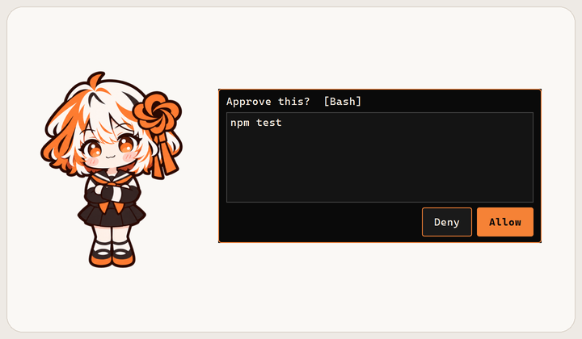
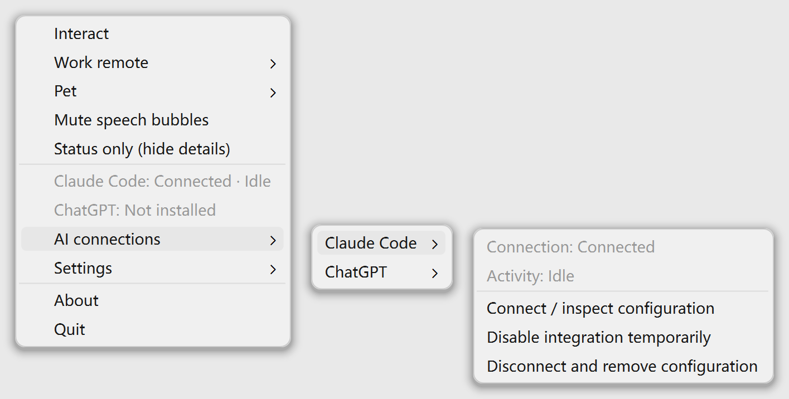
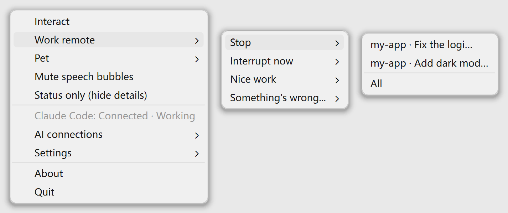

<div align="center">

# Shion · 诗音

**A desktop companion that works alongside Claude Code — and keeps an eye on ChatGPT (Codex) too**


English · [中文](README.zh.md) · [日本語](README.ja.md)

</div>

> [!NOTE]
> **Unofficial project.** Shion is an independent, open-source fan project. It is not affiliated with, endorsed by, or sponsored by Anthropic. "Claude" and "Claude Code" are trademarks of Anthropic, and "ChatGPT" and "Codex" are trademarks of OpenAI; they are used here only to describe compatibility. Shion is not affiliated with OpenAI either.

---

## Who is she?

Shion is a little girl who lives on your desktop. She blinks, breathes, idles, and sometimes talks to herself.
While you work with Claude Code (or ChatGPT's Codex), she **keeps you company**: she gets serious when it starts working, lets you know when it's done, and brings permission requests right to you.

She doesn't read your code, doesn't go online, and doesn't chat with the AI on your behalf. She's just there with you.

## Features

### Claude Code integration
- **Status awareness**: changes expression and speaks up when work starts, finishes, fails, or needs your confirmation
- **Answer permission requests**: when Claude Code wants to run a command or edit a file, Shion shows a panel with **Allow / Deny** (you can still answer inside Claude Code; whichever comes first wins — **she never allows anything by default**)
- **Stop / Continue**: pauses at the next tool checkpoint, shows a "Paused" label, one click to continue
- **Interrupt now**: stops the running tool process and ends the turn at the next checkpoint; an ongoing text reply may finish its current sentence first. If the working process cannot be found, Shion pauses at the next checkpoint instead
- **Nice work / Something's wrong...**: quietly passes your feedback to the working AI as added context (no extra chat message appears)
- **Plan and completion reminders**: she only tells you to go look — no content is shown on your desktop
- **Several sessions at once**: when more than one Claude Code session is working, Stop, Interrupt now, Nice work and Something's wrong... in **Work remote** open a submenu so you can pick one session (or **All**). Sessions are named after their project folder; two sessions in the same project also show the first few characters of their first message
- **Disable integration temporarily**: right-click → **AI connections** → **Claude Code** → **Disable integration temporarily**. While it's off, Shion shows no panels and Claude Code handles permission requests itself; turn it back on at any time
- **No slowdown when Shion isn't running**: hooks notice right away and hand control straight back to Claude Code, with no waiting

### ChatGPT (Codex) observation
- Works with the Codex CLI and the Codex desktop app: Shion changes expression and speaks up when work starts, tools run, approval is needed, or the work is done
- **Observation only**: she can't approve, stop or interrupt Codex for you; when Codex needs you, she just reminds you to go back and check
- Managed separately from Claude Code: install, temporarily disable or remove it under right-click → **AI connections** → **ChatGPT**

### Everyday interaction
- Headpats (with hearts), pokes, cheek pinches, tickles, picking her up and shaking her (she gets dizzy)
- Open **Talk → Give a snack**, or pick a preset conversation (no AI model involved)
- **Actions**: **Jump**, **Go to bed**, or **Rest at the desk**
- Time-aware greetings: asks about breakfast in the morning, tells you to sleep late at night
- **Affection**: grows slowly through headpats, snacks and talks; five levels unlock new talks, snacks and lines
- 中文 / English / 日本語

### Stays out of your way
- Click-through on transparent areas
- Panels appear **without taking keyboard focus**. Clicking the conversation window enables number-key selection; clicking the feedback input lets you type
- "Always on top" can be turned off. When a Claude desktop app or Codex desktop app window comes to the foreground, Shion follows its window layer and stays just above it
- **Mute speech bubbles**, **Status only (hide details)**, four sizes and adjustable **Activity**

<table>
  <tr>
    <td align="center"><br>Headpats bring out little hearts.</td>
    <td align="center"><br>Rest at the desk for a quiet moment.</td>
  </tr>
  <tr>
    <td align="center"><br>Choose Allow or Deny for a permission request.</td>
    <td align="center"><br>Go to bed and drift off to sleep.</td>
  </tr>
  <tr>
    <td align="center"><br>Manage Claude Code and ChatGPT under AI connections.</td>
    <td align="center"><br>With several sessions, stop just one of them.</td>
  </tr>
</table>

## Requirements

- Windows 10 / 11 (macOS / Linux not supported yet)
- [Claude Code](https://docs.claude.com/en/docs/claude-code) (the CLI or Code in the desktop app) and/or Codex (the CLI or the desktop app). Shion also works as a plain desktop pet without either

## Install

1. Download `Shion-2.0.0-win64.zip` from [Releases](../../releases)
2. Extract it to a **permanent location**, e.g. `D:\Apps\Shion` (if you move it later, reconnect via right-click → **AI connections** → **Claude Code** → **Connect / inspect configuration**)
3. Run `Shion.exe`
4. On first launch Shion asks whether to connect to Claude Code — click **Connect**

No Python required.

> [!TIP]
> If Windows SmartScreen says "Windows protected your PC", click **More info → Run anyway**. This warning can appear because the app is not code-signed.

## Connecting to Claude Code

"Connect" adds Shion's hooks to your **user-level** config `%USERPROFILE%\.claude\settings.json`, so it works in every project.

- The original file is backed up first (`settings.json.shion-backup-<time>`)
- Only Shion's own entries are added or removed; all your other settings stay as they are
- If the file is malformed, Shion refuses to write rather than risk breaking it
- You can **right-click → AI connections → Claude Code → Disconnect and remove configuration** at any time; to pause for a while, choose **Disable integration temporarily** instead
- If an older source checkout has project-level Shion hooks, run `tools\uninstall_hooks.py` there before connecting with the exe; the exe cannot migrate those old project hooks

Only **newly started** Claude Code sessions pick up the change.

## Connecting to ChatGPT (Codex)

The ChatGPT integration is installed separately: right-click → **AI connections** → **ChatGPT** → **Connect / inspect configuration**.

- Shion first shows the exact changes to your Codex config (`config.toml` and `hooks.json`, by default in `%USERPROFILE%\.codex`) and writes only after you confirm. Only Shion's own entries are inserted and no copy of your config is kept; disconnecting removes exactly those entries, and if they no longer match, Shion stops instead of overwriting your edits
- Afterwards, review each Shion hook in Codex with `/hooks` and check the connection with `/mcp`. After the first install, restart Codex, then start or reopen a session
- **Disable integration temporarily** and **Disconnect and remove configuration** are in the same submenu

## How to use

| Action | Effect |
|---|---|
| Left click | Poke |
| Hold left button and move over her head | Headpat |
| Drag a cheek sideways | Pinch her cheek |
| Click her tummy 3 times / rub back and forth | Tickle |
| Drag | Pick her up; she stays where you drop her. Shake hard and she gets dizzy |
| Double click | Status (time together, affection level, connection) |
| Right click | Menu: Interact, Work remote, Pet (Expression, Actions, Size…), AI connections, Settings (Language, Start with Windows)… |

## Privacy

- Everything stays on your machine: the local server listens on `127.0.0.1` only and rejects requests from web pages
- **No external network connections, no uploads, no AI model calls**; hooks communicate over localhost
- Shion receives hook events, including action details for permission requests. Ordinary activity uses short summaries; details such as file names can appear in local logs. Code files and conversation transcripts are not saved
- **Status only (hide details)** hides activity details and omits them from new event log entries; existing logs remain. Permission panels still show the action you need to approve
- Hooks and Shion authenticate each other with a one-time token (a new one every time Shion starts), and the local port is bound exclusively, to stop other programs on your PC from pretending to be Shion or a hook
- When several Claude Code sessions run in the same project, Shion keeps the first few characters of each session's first message in memory, only to tell them apart in the menu. They are not logged or saved and are gone when she quits; with **Status only (hide details)** on, hooks don't send them at all
- ChatGPT (Codex) observation also stays on your machine, and Shion cannot operate Codex
- Save data and logs live in `%APPDATA%\Shion`

## FAQ

**Shion doesn't react.**
Double-click her and check the connection status. If it says "Invalid path or incomplete connection", check the app location and reconnect via right-click → **AI connections** → **Claude Code** → **Connect / inspect configuration**. Then start a **new** Claude Code session.

**Shion doesn't start by itself when I use Codex.**
Claude Code sessions can launch Shion for you, but Codex sessions don't. If you use Codex, right-click → **Settings** → turn on **Start with Windows** so she is already there when you start working.

**ChatGPT (Codex) started working but Shion doesn't react.**
The Codex desktop app doesn't send a "work started" event, so Shion shows "Working" only after its first tool call. If she never reacts, check in Codex with `/hooks` that Shion's hooks are approved, then restart Codex.

**"Port already in use".**
Shion uses local port `47613`. Make sure only one Shion is running.

**My antivirus flags it.**
Apps packaged with PyInstaller are occasionally misdetected. You can review the source and build it yourself (see below), or whitelist the folder.

**How do I uninstall?**
1. Right-click → **AI connections** → **Claude Code** → **Disconnect and remove configuration** (removes Shion's hooks from your Claude Code config); if you installed the ChatGPT integration, do the same under **ChatGPT**
2. Right-click → turn off "Start with Windows" if enabled
3. Right-click → **Quit**, then delete the app folder and `%APPDATA%\Shion` (save data and logs)

## Known limitations

- **Planned V2.1 stamina (not implemented yet):** quota data was observed only in the Claude Code terminal probe; existing and new Desktop Code sessions produced no statusLine records. Desktop hook fallbacks remain unverified.
- ChatGPT (Codex) is observation only: Shion can't approve, stop or interrupt it, and **Work remote** applies to Claude Code only
- The Codex desktop app sends no "start" event, so "Working" appears only after its first tool call
- Codex doesn't launch Shion automatically (see the FAQ above; turning on **Start with Windows** helps)
- Real-world testing with the Codex desktop app is still limited, so its status may occasionally be off

## Run from source

```bat
git clone https://github.com/iLLyaaaaaa/shion.git
cd shion
python -m venv .venv
.venv\Scripts\pip install -r requirements.txt
start.bat
```

Requires Python 3.10+. The sprites are already processed; `tools/process_sprites.py` needs the unpublished original images, so regular users do not need to run it. Build: `.venv\Scripts\python tools\build.py` (output in `dist\Shion\`). Tests: `.venv\Scripts\python -m pytest -q`.

## License

This project is licensed in two parts:

| Content | License | What you can do |
|---|---|---|
| Code and other content (except Shion's character images; includes dialogue and menu data) | [MIT](LICENSE) | Almost anything, including commercial use, while retaining copyright and license notices |
| Shion's character images (currently including `assets/sprites/`, `docs/images/` and `assets/icon/`) | [CC BY-NC 4.0](assets/LICENSE) | Share and adapt with attribution, a license link and change notices; **non-commercial only** |

Shion / 诗音 is an original character by iLLyaaaaaa. Shion's character images, currently including `assets/sprites/`, `docs/images/` (screenshots, `hero.gif` and icon previews) and `assets/icon/`, use CC BY-NC 4.0. This also covers future Shion character icons (`.ico` / `.png`). Other content, including dialogue and menu data, uses MIT like the code. You may build your own desktop pet from the code; Shion's artwork is for non-commercial use only.

## Credits

- Character design & art: [iLLyaaaaaa](https://github.com/iLLyaaaaaa) (original character, made with the help of AI image tools)
- Developed with the help of AI coding tools

---

<div align="center">
<sub>Shion is an unofficial personal project and is not affiliated with Anthropic or OpenAI.</sub>
</div>

The ChatGPT integration uses tomlkit (MIT); see [third-party notices](THIRD_PARTY_NOTICES.md).
