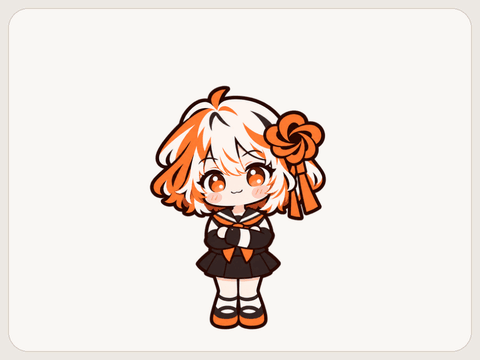
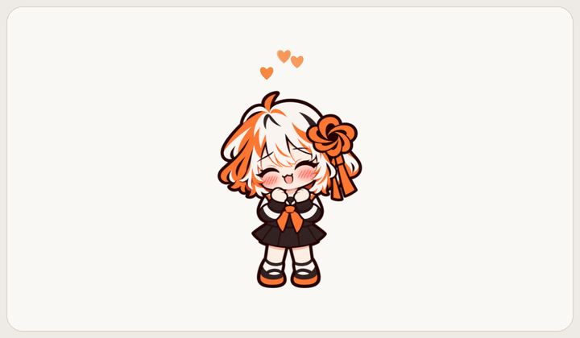
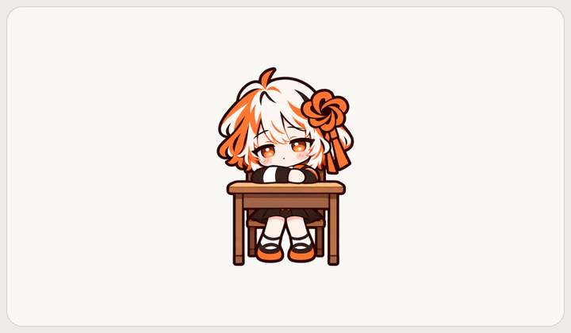
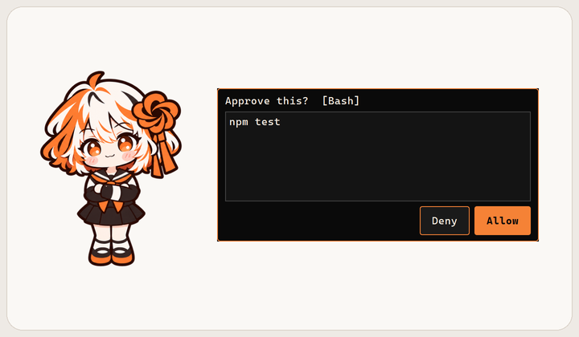
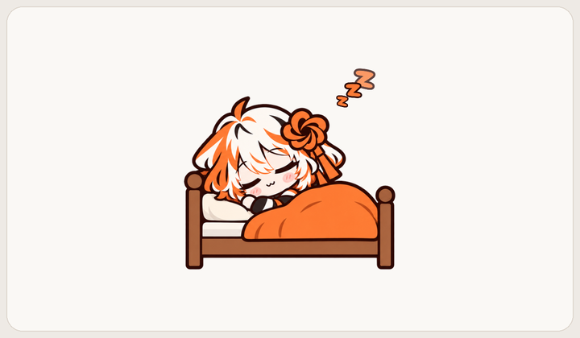

<div align="center">

# Shion · 诗音

**A desktop companion that works alongside Claude Code**



English · [中文](README.zh.md) · [日本語](README.ja.md)

</div>

> [!NOTE]
> **Unofficial project.** Shion is an independent, open-source fan project. It is not affiliated with, endorsed by, or sponsored by Anthropic. "Claude" and "Claude Code" are trademarks of Anthropic and are used here only to describe compatibility.

---

## Who is she?

Shion is a little girl who lives on your desktop. She blinks, breathes, idles, and sometimes talks to herself.
While you work with Claude Code, she **keeps you company**: she gets serious when it starts working, lets you know when it's done, and brings permission requests right to you.

She doesn't read your code, doesn't go online, and doesn't chat with the AI on your behalf. She's just there with you.

## Features

### Claude Code integration
- **Status awareness**: changes expression and speaks up when work starts, finishes, fails, or needs your confirmation
- **Answer permission requests**: when Claude Code wants to run a command or edit a file, Shion shows a panel with **Allow / Deny** (you can still answer inside Claude Code; whichever comes first wins — **she never allows anything by default**)
- **Stop / Continue**: pauses at the next tool checkpoint, shows a "Paused" label, one click to continue
- **Interrupt now**: stops the running tool process and ends the turn at the next checkpoint; an ongoing text reply may finish its current sentence first. If the working process cannot be found, Shion pauses at the next checkpoint instead
- **Nice work / Something's wrong...**: quietly passes your feedback to the working AI as added context (no extra chat message appears)
- **Plan and completion reminders**: she only tells you to go look — no content is shown on your desktop

### Everyday interaction
- Headpats (with hearts), pokes, cheek pinches, tickles, picking her up and shaking her (she gets dizzy)
- Open **Talk → Give a snack**, or pick a preset conversation (no AI model involved)
- **Actions**: **Jump**, **Turn around**, **Go to bed**, or **Rest at the desk**
- Time-aware greetings: asks about breakfast in the morning, tells you to sleep late at night
- **Affection**: grows slowly through headpats, snacks and talks; five levels unlock new talks, snacks and lines
- 中文 / English / 日本語

### Stays out of your way
- Click-through on transparent areas
- Panels appear **without taking keyboard focus**. Clicking the conversation window enables number-key selection; clicking the feedback input lets you type
- "Always on top" can be turned off. When a Claude desktop app window comes to the foreground, Shion follows its window layer and stays just above it
- **Mute speech bubbles**, **Status only (hide details)**, four sizes and adjustable **Activity**

<table>
  <tr>
    <td align="center"><br>Headpats bring out little hearts.</td>
    <td align="center"><br>Rest at the desk for a quiet moment.</td>
  </tr>
  <tr>
    <td align="center"><br>Choose Allow or Deny for a permission request.</td>
    <td align="center"><br>Go to bed and drift off to sleep.</td>
  </tr>
</table>

## Requirements

- Windows 10 / 11 (macOS / Linux not supported yet)
- [Claude Code](https://docs.claude.com/en/docs/claude-code) — either the CLI or Code in the desktop app. Shion also works as a plain desktop pet without it

## Install

1. Download `Shion-1.0.0-win64.zip` from [Releases](../../releases)
2. Extract it to a **permanent location**, e.g. `D:\Apps\Shion` (if you move it later, right-click → **Reconnect to Claude Code**)
3. Run `Shion.exe`
4. On first launch Shion asks whether to connect to Claude Code — click **Connect**

No Python required.

> [!TIP]
> If Windows SmartScreen says "Windows protected your PC", click **More info → Run anyway**. This warning can appear because the app is not code-signed.

## Connecting to Claude Code

"Connect" adds Shion's hooks to your **user-level** config `%USERPROFILE%\.claude\settings.json`, so it works in every project.

- The original file is backed up first (`settings.json.shion-backup-<time>`)
- Only Shion's own entries are added or removed; all your other settings stay as they are
- If the file is malformed, Shion refuses to write rather than risk breaking it
- You can **right-click → Disconnect** at any time
- If an older source checkout has project-level Shion hooks, run `tools\uninstall_hooks.py` there before connecting with the exe; the exe cannot migrate those old project hooks

Only **newly started** Claude Code sessions pick up the change.

## How to use

| Action | Effect |
|---|---|
| Left click | Poke |
| Hold left button and move over her head | Headpat |
| Drag a cheek sideways | Pinch her cheek |
| Click her tummy 3 times / rub back and forth | Tickle |
| Drag | Pick her up; she stays where you drop her. Shake hard and she gets dizzy |
| Double click | Status (time together, affection level, connection) |
| Right click | Menu: Talk, Work remote, Expression, Actions, Size, Language, Start with Windows… |

## Privacy

- Everything stays on your machine: the local server listens on `127.0.0.1` only and rejects requests from web pages
- **No external network connections, no uploads, no AI model calls**; hooks communicate over localhost
- Shion receives hook events, including action details for permission requests. Ordinary activity uses short summaries; details such as file names can appear in local logs. Code files and conversation transcripts are not saved
- **Status only (hide details)** hides activity details and omits them from new event log entries; existing logs remain. Permission panels still show the action you need to approve
- Save data and logs live in `%APPDATA%\Shion`

## FAQ

**Shion doesn't react.**
Double-click her and check the connection status. If it says "Invalid path or incomplete connection", check the app location and right-click → **Reconnect to Claude Code**. Then start a **new** Claude Code session.

**"Port already in use".**
Shion uses local port `47613`. Make sure only one Shion is running.

**My antivirus flags it.**
Apps packaged with PyInstaller are occasionally misdetected. You can review the source and build it yourself (see below), or whitelist the folder.

**How do I uninstall?**
1. Right-click → **Disconnect** (removes Shion's hooks from your Claude Code config)
2. Right-click → turn off "Start with Windows" if enabled
3. Right-click → **Quit**, then delete the app folder and `%APPDATA%\Shion` (save data and logs)

## Run from source

```bat
git clone https://github.com/iLLyaaaaaa/shion.git
cd shion
python -m venv .venv
.venv\Scripts\pip install -r requirements.txt
start.bat
```

Requires Python 3.10+. The sprites are already processed; `tools/process_sprites.py` needs the unpublished original images, so regular users do not need to run it. Build: `.venv\Scripts\python tools\build.py` (output in `dist\Shion\`). Tests: `.venv\Scripts\python -m pytest -q`.

## License

This project is licensed in two parts:

| Content | License | What you can do |
|---|---|---|
| Code and other content (except Shion's character images; includes dialogue and menu data) | [MIT](LICENSE) | Almost anything, including commercial use, while retaining copyright and license notices |
| Shion's character images (currently including `assets/sprites/`, `docs/images/` and `assets/icon/`) | [CC BY-NC 4.0](assets/LICENSE) | Share and adapt with attribution, a license link and change notices; **non-commercial only** |

Shion / 诗音 is an original character by iLLyaaaaaa. Shion's character images, currently including `assets/sprites/`, `docs/images/` (screenshots, `hero.gif` and icon previews) and `assets/icon/`, use CC BY-NC 4.0. This also covers future Shion character icons (`.ico` / `.png`). Other content, including dialogue and menu data, uses MIT like the code. You may build your own desktop pet from the code; Shion's artwork is for non-commercial use only.

## Credits

- Character design & art: [iLLyaaaaaa](https://github.com/iLLyaaaaaa) (original character, made with the help of AI image tools)
- Developed with the help of AI coding tools

---

<div align="center">
<sub>Shion is an unofficial personal project and is not affiliated with Anthropic.</sub>
</div>
