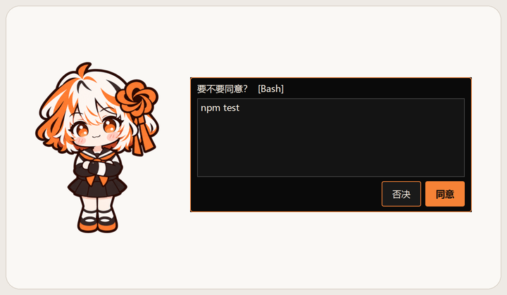
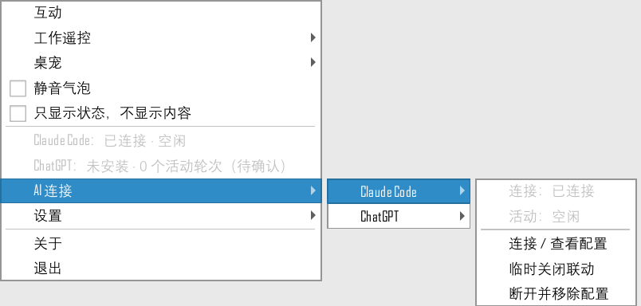
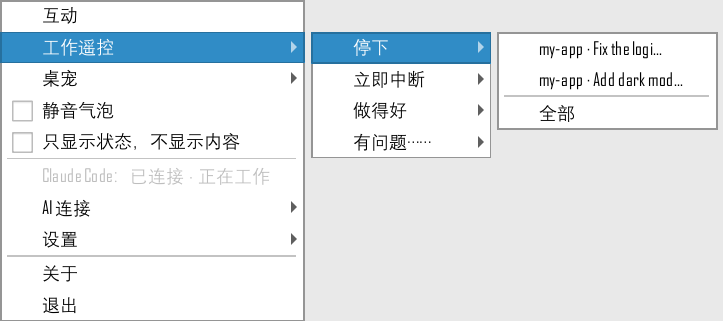

<div align="center">

# Shion · 诗音

**一个能和 Claude Code 联动、也能陪你看着 ChatGPT（Codex）干活的桌宠**


[English](README.md) · 中文 · [日本語](README.ja.md)

</div>

> [!NOTE]
> **非官方作品。** Shion 是个人制作的开源项目，与 Anthropic 无关，未获其认可、赞助或合作。“Claude”和“Claude Code”是 Anthropic 的商标，“ChatGPT”和“Codex”是 OpenAI 的商标，本项目只用它们说明兼容性，与 OpenAI 也没有任何关系。

---

## 她是谁

诗音是一个住在你桌面上的小女孩，平时会自己发呆、眨眼、呼吸、偶尔自言自语。
你用 Claude Code（或 ChatGPT 的 Codex）干活时，她会**陪在旁边**：它开始工作她就跟着认真起来，做完了提醒你去看，需要你点头时把问题递到你眼前。

她不会读你的代码，不会联网，也不会替你和 AI 聊天。她只是陪着你。

## 功能

### 和 Claude Code 联动
- **状态感知**：工作中、完成、出错、等你确认时会换表情、说话提醒
- **授权代答**：Claude Code 请求执行命令或修改文件时，诗音会弹出面板，直接点“同意 / 否决”（在 Claude Code 里自己答也可以，两边哪边先答都行；**永远不会默认同意**）
- **停下 / 继续**：在下一个工具检查点原地暂停，头顶显示“暂停中”，点一下就继续
- **立即中断**：先停止正在运行的工具进程，再在下一个检查点结束这一轮；正在输出的文字可能要等当前这句说完。找不到工作进程时，改为在下一个检查点暂停
- **做得好 / 有问题……**：把你的评价悄悄转告给正在干活的 AI（作为上下文附加，不会在对话里多出一条消息）
- **计划和完成提醒**：只提醒你去看，不在桌面上显示具体内容
- **多个会话一起干活**：同时开着几个 Claude Code 会话时，“工作遥控”里的停下、立即中断、做得好、有问题……会展开成子菜单，可以只选其中一个会话（或“全部”）。子菜单用项目文件夹名区分；同一个项目开了两个会话时，再加上各自第一句话的前几个字
- **临时关闭联动**：右键 → “AI 连接” → “Claude Code” → “临时关闭联动”。关闭期间诗音不弹面板，授权交回 Claude Code 自己处理；随时可以重新开启
- **诗音没开时不拖慢 Claude Code**：hook 发现诗音没在运行会立刻交回 Claude Code 自己处理，不再等待

### ChatGPT（Codex）只读观察
- 支持 Codex CLI 和 Codex 桌面端：开始工作、调用工具、等待授权、完成时，诗音会换表情、说话提醒
- **只观察，不代为操作**：不能替你授权、停下或中断 Codex，需要你确认时她只会提醒你回 Codex 那边去看
- 和 Claude Code 分开管理：右键 → “AI 连接” → “ChatGPT” 里单独安装、临时关闭或移除

### 日常互动
- 摸头（会冒爱心）、戳、捏脸、挠痒、拎起来晃（会晕）
- 右键“对话 → 喂零食”，或选一句预设对话和她聊聊（不调用任何模型）
- 动作菜单：跳一跳、去睡觉（床睡）、趴一会儿（趴桌）
- 会按时间打招呼：早上问早饭、深夜催你睡觉
- **好感度**：摸头、喂零食、聊天会慢慢增加，五个等级会解锁新的对话、零食和台词
- 中文 / English / 日本語 三种语言

### 不打扰你
- 透明区域可以点穿，不会挡住下面的窗口
- 面板出现时**不主动获取键盘焦点**。点击对话窗口后可用数字键选择；点击反馈输入框后可打字
- 可以关掉“置于最上层”；关掉后，Claude 桌面应用或 Codex 桌面端窗口回到前台时，她会跟随窗口层级，待在它上面
- 静音气泡、“只显示状态，不显示内容”、调大小（四档）、调活跃度

<table>
  <tr>
    <td align="center"><br>摸摸头，冒出小爱心。</td>
    <td align="center"><br>选择“趴一会儿”，安静休息。</td>
  </tr>
  <tr>
    <td align="center"><br>授权请求可点“同意 / 否决”。</td>
    <td align="center"><br>选择“去睡觉”，钻进小床。</td>
  </tr>
  <tr>
    <td align="center"><br>“AI 连接”里分别管理 Claude Code 和 ChatGPT。</td>
    <td align="center"><br>多个会话时，可以只停下其中一个。</td>
  </tr>
</table>

## 系统要求

- Windows 10 / 11（暂不支持 macOS / Linux）
- 已安装 [Claude Code](https://docs.claude.com/en/docs/claude-code)（终端版或桌面应用里的 Code 都可以），和/或 Codex（CLI 或桌面端）。都不连接也能当普通桌宠用

## 安装

1. 到 [Releases](../../releases) 下载 `Shion-2.0.0-win64.zip`
2. 解压到一个**固定的位置**，例如 `D:\Apps\Shion`（挪动后可右键 → “AI 连接” → “Claude Code” → “连接 / 查看配置”重新连接）
3. 双击 `Shion.exe`
4. 第一次启动时，诗音会问你要不要连接 Claude Code，点 **连接**

不需要安装 Python。

> [!TIP]
> 如果 Windows 提示“Windows 已保护你的电脑”，点 **更多信息 → 仍要运行**。未进行代码签名的程序可能会出现这个提示。

## 连接 Claude Code

点“连接”后，诗音会把自己的 hooks 写进**用户级**配置 `%USERPROFILE%\.claude\settings.json`，之后在任何文件夹打开 Claude Code 都能联动。

- 修改前会自动备份原文件（`settings.json.shion-backup-时间`）
- 只增删诗音自己的条目，你的其他设置原样保留
- 配置文件格式有问题时拒绝写入，不会把它弄坏
- 以后随时可以 **右键 → “AI 连接” → “Claude Code” → “断开并移除配置”**；只想暂停一下就选“临时关闭联动”
- 如果旧源码项目装过项目级诗音 hooks，请先在旧项目运行 `tools\uninstall_hooks.py`，再用 exe 连接；exe 无法迁移那些旧项目 hooks

连接之后，**新开的** Claude Code 会话才会生效。

## 连接 ChatGPT（Codex）

ChatGPT 联动需要另外安装：右键 → “AI 连接” → “ChatGPT” → “连接 / 查看配置”。

- 诗音会先列出要写进 Codex 配置（默认在 `%USERPROFILE%\.codex` 下的 `config.toml`、`hooks.json`）的差异，你确认后才写入；写入前自动备份，只改诗音自己的条目
- 装好后，在 Codex 里用 `/hooks` 逐项审核诗音的 Hook，并用 `/mcp` 检查连接；第一次安装后请重启 Codex，再新建或重新打开会话
- 随时可以在同一个子菜单里“临时关闭联动”或“断开并移除配置”

## 使用方法

| 操作 | 效果 |
|---|---|
| 左键点击 | 戳她 |
| 在头顶来回移动（按住左键） | 摸头 |
| 拖着脸颊往两边拉 | 捏脸 |
| 点肚子三下 / 按住来回蹭 | 挠痒 |
| 拖动 | 拎起来，放手后停在原地；用力晃会晕 |
| 双击 | 查看状态（陪伴时长、好感等级、连接状态） |
| 右键 | 菜单：互动、工作遥控、桌宠（表情、动作、大小……）、AI 连接、设置（语言、开机自启）…… |

## 隐私

- 诗音只在本机工作：本地服务只监听 `127.0.0.1`，并拒绝来自网页的请求
- **不连接外部网络、不上传任何数据、不调用任何 AI 模型**；hooks 只通过本机地址通信
- 她接收 Claude Code 通过 hooks 发送的事件，包括授权请求的操作详情。普通活动使用简短摘要；文件名等详情可能写入本地日志，不保存代码文件或对话正文
- “只显示状态，不显示内容”会隐藏活动详情，并省略之后事件日志里的详情；已有日志仍会保留。授权面板仍会显示待你确认的操作
- hook 和诗音之间用一次性令牌认证（每次启动诗音都会换新），本地端口独占，防止本机其他程序冒充诗音或 hook
- 同一项目开了多个 Claude Code 会话时，诗音会在内存里保存每个会话第一句话的前几个字，只用来在菜单里区分会话：不写日志、不存档，退出就没了；开着“只显示状态，不显示内容”时 hook 不会发送这几个字
- ChatGPT（Codex）的观察同样只在本机进行，诗音不能操作 Codex
- 存档和日志在 `%APPDATA%\Shion`

## 常见问题

**诗音没有反应？**
双击她查看“连接”一栏。如果显示“路径失效或连接不完整”，检查程序位置，再右键 → “AI 连接” → “Claude Code” → “连接 / 查看配置”重新连接。连接后要**新开**一个 Claude Code 会话。

**用 Codex 时诗音没有自动出现？**
Claude Code 新开会话时可以帮你拉起诗音，Codex 不会。使用 Codex 时，建议右键 → “设置” → 开启“开机自启”，这样开机后她就一直在了。

**ChatGPT（Codex）开始干活了，诗音却没反应？**
Codex 桌面端不会发出“开始工作”的事件，诗音要等它第一次调用工具后才显示“工作中”。如果一直没反应，到 Codex 里用 `/hooks` 确认诗音的 Hook 已经审核通过，再重启 Codex。

**提示端口被占用？**
诗音使用本机端口 `47613`。请确认没有同时打开两个诗音。

**杀毒软件报毒？**
用 PyInstaller 打包的程序偶尔会被误报。你可以查看源码自行构建（见下方“从源码运行”），或把程序目录加入白名单。

**怎么卸载？**
1. 右键 → “AI 连接” → “Claude Code” → **断开并移除配置**（从 Claude Code 配置里删掉诗音的 hooks）；装过 ChatGPT 联动的，在“ChatGPT”子菜单里同样操作一次
2. 右键 → 取消“开机自启”（如果开了）
3. 右键 → “退出”，再删除程序文件夹，以及 `%APPDATA%\Shion`（存档和日志）

## 已知限制

- ChatGPT（Codex）只观察：不能代为授权、停下或中断，“工作遥控”只对 Claude Code 有效
- Codex 桌面端收不到“开始”事件，要等第一次调用工具后才显示工作中
- Codex 不会自动拉起诗音（见上方常见问题，建议开启“开机自启”）
- Codex 桌面端目前只做了有限的实机验证，个别情况下状态可能不准

## 从源码运行

```bat
git clone https://github.com/iLLyaaaaaa/shion.git
cd shion
python -m venv .venv
.venv\Scripts\pip install -r requirements.txt
start.bat
```

需要 Python 3.10+。精灵图已处理好；`tools/process_sprites.py` 需要未公开的原图，普通用户不需要运行。打包：`.venv\Scripts\python tools\build.py`，产物在 `dist\Shion\`。运行测试：`.venv\Scripts\python -m pytest -q`。

## 许可

本项目分两部分授权：

| 内容 | 许可 | 可以做什么 |
|---|---|---|
| 代码及其他内容（诗音角色图片除外，包括台词和菜单数据） | [MIT](LICENSE) | 几乎随意使用，包括商用，须保留版权及许可声明 |
| 诗音的角色图片（目前包括 `assets/sprites/`、`docs/images/`、`assets/icon/`） | [CC BY-NC 4.0](assets/LICENSE) | 可转载、修改，须署名、附许可证链接并注明修改，且**不能商用** |

Shion / 诗音为 iLLyaaaaaa 原创角色。诗音的角色图片，目前包括 `assets/sprites/`、`docs/images/`（截图、`hero.gif` 和图标预览）、`assets/icon/`，使用 CC BY-NC 4.0；以后新增的诗音角色图标（`.ico` / `.png`）也适用。台词、菜单数据等其他内容与代码一样使用 MIT。你可以拿代码做自己的桌宠，诗音的角色图片仅限非商业使用。

## 致谢

- 角色设计与美术：[iLLyaaaaaa](https://github.com/iLLyaaaaaa)（原创角色，借助 AI 绘图工具制作）
- 开发过程中使用了 AI 辅助编程工具

---

<div align="center">
<sub>Shion 是非官方的个人作品，与 Anthropic、OpenAI 无关。</sub>
</div>

ChatGPT 联动使用 tomlkit（MIT），见[第三方许可声明](THIRD_PARTY_NOTICES.md)。
