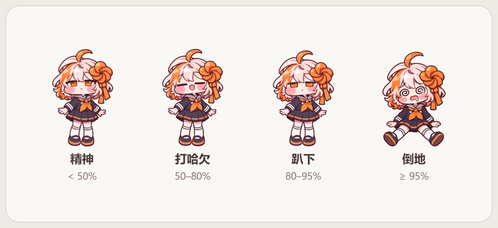
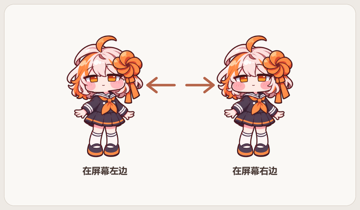
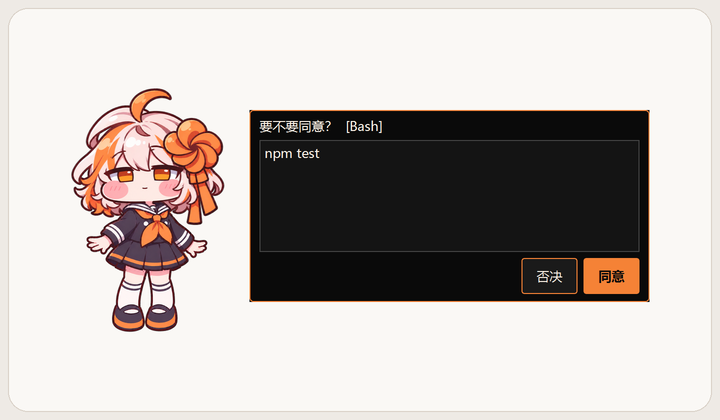
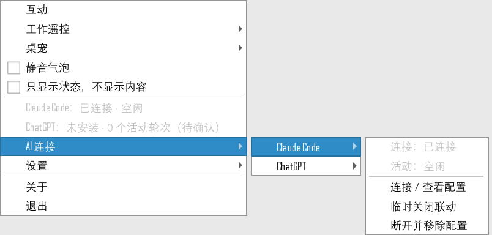
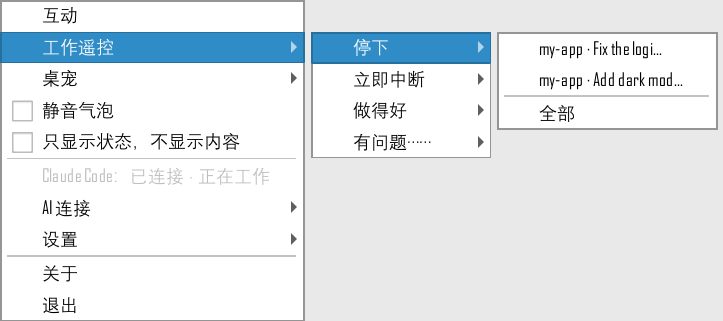

<div align="center">

# Shion · 诗音

**一个能和 Claude Code 联动、也能陪你看着 ChatGPT（Codex）干活的桌宠**


[English](README.md) · 中文 · [日本語](README.ja.md)

</div>

> [!NOTE]
> **非官方作品。** Shion 是个人制作的开源项目，与 Anthropic 无关，未获其认可、赞助或合作。“Claude”和“Claude Code”是 Anthropic 的商标，“ChatGPT”和“Codex”是 OpenAI 的商标，本项目只用它们说明兼容性，与 OpenAI 也没有任何关系。

---

## 她是谁

诗音是一个住在你桌面上的小女孩，平时会自己发呆、眨眼、呼吸、偶尔自言自语。她是纸偶风格的立绘：会呼吸、眨眼，发丝也会轻轻摆动。
你用 Claude Code、Claude 桌面版聊天（或 ChatGPT 的 Codex）干活时，她会**陪在旁边**：它开始工作她就跟着认真起来，做完了提醒你去看，需要你点头时把问题递到你眼前。

她不会读你的代码，不会联网，也不会替你和 AI 聊天。她只是陪着你。

## 功能

### 和 Claude Code 联动
- **状态感知**：工作中、完成、出错、等你确认时会换表情、说话提醒
- **授权代答**：Claude Code 请求执行命令或修改文件时，诗音会弹出面板，直接点“同意 / 否决”（在 Claude Code 里自己答也可以，两边哪边先答都行；**永远不会默认同意**）
- **看清授权内容再决定**：面板先用直白的文字说明操作。Bash 和 PowerShell 的完整命令始终显示，长命令可以滚动。可识别的操作会有简短摘要，Claude 提供的说明会标明来源，常见危险操作会显示红色提醒。点“详情”可以查看原始工具名和 hook 已发送的信息。
- **停下 / 继续**：在下一个工具检查点原地暂停，头顶显示“暂停中”，点一下就继续
- **立即中断**：先停止正在运行的工具进程，再在下一个检查点结束这一轮；正在输出的文字可能要等当前这句说完。找不到工作进程时，改为在下一个检查点暂停
- **做得好 / 有问题……**：把你的评价悄悄转告给正在干活的 AI（作为上下文附加，不会在对话里多出一条消息）
- **计划和完成提醒**：提醒你回到会话查看计划和回复
- **多个会话一起干活**：同时开着几个 Claude Code 会话时，“工作遥控”里的停下、立即中断、做得好、有问题……会展开成子菜单，可以只选其中一个会话（或“全部”）。子菜单用项目文件夹名区分；同一个项目开了两个会话时，再加上各自第一句话的前几个字
- **临时关闭联动**：右键 → “AI 连接” → “Claude Code” → “临时关闭联动”。关闭期间诗音不弹面板，授权交回 Claude Code 自己处理；随时可以重新开启
- **诗音没开时不拖慢 Claude Code**：hook 发现诗音没在运行会立刻交回 Claude Code 自己处理，不再等待

### Claude 桌面版聊天联动
- **聊天状态提醒**：连接后，Claude 在聊天里做需要工具或耗时较长的任务时会通知诗音：开始时她跟着认真起来，需要你回话时提醒你，做完了叫你去看（台词会随机换）
- **只观察，不遥控**：聊天不能从诗音暂停或中断。只有聊天在工作时，“工作遥控”整组置灰，要停请在 Claude 里点停止；聊天和 Claude Code 同时工作时，“停下”只暂停 Claude Code，诗音仍显示工作中
- **靠个人偏好触发**：什么时候通知由 Claude 自己决定，需要把诗音提供的一句个人偏好贴进 Claude（见下方“连接 Claude 桌面版聊天”）

### ChatGPT（Codex）只读观察
- 支持 Codex CLI 和 Codex 桌面端：开始工作、调用工具、等待授权、完成时，诗音会换表情、说话提醒
- **只观察，不代为操作**：不能替你授权、停下或中断 Codex，需要你确认时她只会提醒你回 Codex 那边去看
- 和 Claude Code 分开管理：右键 → “AI 连接” → “ChatGPT” 里单独安装、临时关闭或移除

### 任务标签

- 诗音身边的标签显示 Claude Code、Claude 桌面版聊天和 ChatGPT（Codex）的任务。黄色表示等待，蓝点表示工作中，绿色勾表示完成。Claude Code 工作时，拿得到数据就显示当前操作或本轮任务摘要。悬停可看所属会话和更多信息。
- 点击完成项可点掉，出现“全部清除”时可一次清掉。点 **+N** 查看其余任务。等待授权或停在检查点时，点对应的 Claude Code 标签可把面板提到前面。“计划待确认”标签也可点掉。
- 右键 → “设置” → “显示任务标签”可切换显示。“只显示状态，不显示内容”会隐藏任务内容。

<p align="center"><br>任务标签（图中为合成数据）。</p>

### 诗音周报
- 右键 → “诗音周报”：默认打开上一周，窗口里可以切到“本周”。每周一第一次启动时，诗音会举着报告提醒你
- 卡片上有本周称号、Claude Code 的总 token 和输出 token、每天的 token 柱状图、活跃天数、最晚活动，以及诗音自己记下的完成任务、工作时长、批准 / 拒绝、摸头和零食次数
- **API 估价**：按 Anthropic 公开的标准 API 单价估算（价格表日期 2026-11-02），仅供参考；订阅用户实际不按这个计费
- 收到过 7 天额度时，还会显示本周 7 天额度的峰值（这个百分比含聊天等全部用量）
- 可以“保存图片”或“复制到剪贴板”。右键 → “设置”里可以关闭“统计用量”，或取消“周报显示项目链接”
- **token 只统计 Claude Code**：数据来自本机 Claude Code 的对话记录，Claude 网页版和桌面应用里的普通聊天不计入

<p align="center"><br>周报卡片（图中为合成数据）。</p>

### 体力
- 按 Claude Code 的 **5 小时额度** 分四档：用量 < 50% 精神，50–80% 打哈欠，80–95% 趴下，≥ 95% 倒地（整个人累瘫在地的专门姿势）。进入每一档时说一句话；额度重置后满血复活，跳一下
- **四档只在终端版 Claude Code 可用**：数据来自 statusLine 提供的 `rate_limits`（Pro / Max 订阅，会话第一条回复之后才有）
- **桌面应用里的 Code** 不运行 statusLine，只有两档：撞到限额时倒地（`StopFailure` hook），额度自动恢复后复活
- 双击诗音可以看到“5 小时额度”（只显示仍有效的最新数据）和“7 天额度”（最后已知值，收到较久时会注明，例如“73%（3 小时前）”）
- 不知道额度时不猜，也**不按 token 推算**：各模型在额度里的权重和上限没有公开，普通聊天的用量在本机也看不到，推算出来的数字会误导
- 体力只改变待机的样子；授权面板、停下 / 继续等操作照常优先

<p align="center"></p>

### 日常互动
- 摸头（会冒爱心）、敲头（冒金星，连敲会抗议）、戳、挠肚子
- **捏脸**：捏着脸颊往两边拉，松手后鼓着嘴弹回来；短时间连捏会委屈。**捏着脸往上提才能把她拎起来挪动**（拖身体不会动）：放手后停在原地，快甩或放到任务栏会落下，来回晃会晕。首次启动约 10 秒后会提示一次
- 靠近屏幕哪一边，脸就鼓向另一边：把她拎到另一半屏幕放下，她会眨一下眼换边
- 工作时她抱着笔记本电脑，偶尔点点头
- 右键“对话 → 喂零食”，或选一句预设对话和她聊聊（不调用任何模型）
- 动作菜单：跳一跳、去睡觉（床睡）、趴一会儿（趴桌）
- 会按时间打招呼：早上问早饭、深夜催你睡觉
- **好感度**：摸头、喂零食、聊天会慢慢增加，五个等级会解锁新的对话、零食和台词
- 中文 / English / 日本語 三种语言

<table>
  <tr>
    <td align="center"><br>捏着脸颊往两边拉，松手后鼓着嘴弹回。</td>
    <td align="center"><br>捏着脸往上提，把她拎起来。</td>
  </tr>
</table>

<p align="center"><br>工作时她抱着电脑。</p>

<p align="center"><br>靠屏幕哪边，脸就鼓向另一边。</p>

### 不打扰你
- 透明区域可以点穿，不会挡住下面的窗口
- 面板出现时**不主动获取键盘焦点**。点击对话窗口后可用数字键选择；点击反馈输入框后可打字
- 可以关掉“置于最上层”；关掉后，Claude 桌面应用或 Codex 桌面端窗口回到前台时，她会跟随窗口层级，待在它上面
- 静音气泡、“只显示状态，不显示内容”、调大小（四档）、调活跃度

<table>
  <tr>
    <td align="center"><br>摸摸头，冒出小爱心。</td>
    <td align="center"><br>选择“趴一会儿”，安静休息。</td>
  </tr>
  <tr>
    <td align="center"><br>授权请求可点“同意 / 否决”。</td>
    <td align="center"><br>选择“去睡觉”，钻进小床。</td>
  </tr>
  <tr>
    <td align="center"><br>“AI 连接”里分别管理 Claude Code 和 ChatGPT。</td>
    <td align="center"><br>多个会话时，可以只停下其中一个。</td>
  </tr>
</table>

## 系统要求

- Windows 10 / 11（暂不支持 macOS / Linux）
- 下载约 75 MB，解压后约 170 MB。运行时内存比 2.x 高：默认大小下实测约 225 MB，选更大的尺寸会更高
- 已安装 [Claude Code](https://docs.claude.com/en/docs/claude-code)（终端版或桌面应用里的 Code 都可以）、Claude 桌面版（聊天联动），和/或 Codex（CLI 或桌面端）。都不连接也能当普通桌宠用

## 安装

1. 到 [Releases](../../releases) 下载 `Shion-3.0.0-win64.zip`
2. 解压到一个**固定的位置**，例如 `D:\Apps\Shion`（以后挪动位置要重新连接：Claude Code 右键 → “AI 连接” → “Claude Code” → “连接 / 查看配置”；Claude 桌面版聊天要先断开再连接）
3. 双击 `Shion.exe`
4. 第一次启动时，诗音会问你要不要连接 Claude Code，点 **连接**

不需要安装 Python。

**从旧版升级**：存档、好感度和设置照常沿用。解压**覆盖到原文件夹**，Claude Code 和 Claude 桌面版聊天联动都不用重连；解压到**新文件夹**，两者都要在诗音里重新连接（Claude 桌面版聊天要先断开再连接，见下文）。确认新版连接正常后可以删除旧文件夹。

> [!TIP]
> 如果 Windows 提示“Windows 已保护你的电脑”，点 **更多信息 → 仍要运行**。未进行代码签名的程序可能会出现这个提示。

## 连接 Claude Code

点“连接”后，诗音会把自己的 hooks 写进**用户级**配置 `%USERPROFILE%\.claude\settings.json`，之后在任何文件夹打开 Claude Code 都能联动。

- 修改前会自动备份原文件（`settings.json.shion-backup-时间`）
- 只增删诗音自己的条目，你的其他设置原样保留
- 配置文件格式有问题时拒绝写入，不会把它弄坏
- 以后随时可以 **右键 → “AI 连接” → “Claude Code” → “断开并移除配置”**；只想暂停一下就选“临时关闭联动”
- 如果旧源码项目装过项目级诗音 hooks，请先在旧项目运行 `tools\uninstall_hooks.py`，再用 exe 连接；exe 无法迁移那些旧项目 hooks
- 连接时还会接管 `statusLine`（体力用）：如果你原来就有状态栏命令，诗音会用同一份输入照常运行它，并原样输出它的结果；断开时把原来的设置恢复回去

连接之后，**新开的** Claude Code 会话才会生效。

## 连接 Claude 桌面版聊天

右键 → “AI 连接” → “Claude 桌面版” → “连接聊天”：

1. 在 Claude 的开发者设置里点“编辑配置”，记下打开的是哪个配置文件
2. 从托盘**完全退出** Claude（只关窗口不够）
3. 在诗音弹出的窗口里选这个文件。诗音会探测常见位置作为提示，但实际用的是哪个文件，以“编辑配置”打开的为准
4. 重启 Claude，在客户端的工具列表里确认有 `shion_working`、`shion_done`、`shion_need_input`。诗音收到 MCP 的上线消息才算真正连通，只写入配置不代表已经连上
5. 点“复制个人偏好”，粘贴到 Claude 的个人偏好里。复制的是这句话：

   > 做需要用工具或耗时较长的任务时，开始前先调用 shion_working，完成后调用 shion_done；简单问答不用调用。

- 写入前在本机保存备份，只合并诗音自己的 MCP 条目；已有同名条目、配置损坏、有重复的键，或写入期间配置被改动，都会停下不写
- **断开**：先完全退出 Claude，再点“断开聊天”，之后重启 Claude。配置没有别的改动时按字节恢复原文件；有别的改动时只移除诗音登记且没被改过的条目，其他新增配置保留
- 如果断开时配置文件已被删除、损坏，或 shion 条目被改过，诗音会问你要不要“清除连接记录”：只删诗音这边的记录、不动配置，之后请自己打开配置文件，看看是否还留有 shion 条目

## 连接 ChatGPT（Codex）

ChatGPT 联动需要另外安装：右键 → “AI 连接” → “ChatGPT” → “连接 / 查看配置”。

- 诗音会先列出要写进 Codex 配置（默认在 `%USERPROFILE%\.codex` 下的 `config.toml`、`hooks.json`）的差异，你确认后才写入。只插入诗音自己的条目，不另存配置副本；断开时按记录精确移除，配置被改得对不上时会停下，不会覆盖你的修改
- 装好后，在 Codex 里用 `/hooks` 逐项审核诗音的 Hook，并用 `/mcp` 检查连接；第一次安装后请重启 Codex，再新建或重新打开会话
- 随时可以在同一个子菜单里“临时关闭联动”或“断开并移除配置”

## 使用方法

| 操作 | 效果 |
|---|---|
| 左键点击 | 戳她 |
| 在头顶来回移动（按住左键） | 摸头 |
| 单击头顶 | 敲头（冒金星，连敲会抗议） |
| 捏着脸颊往两边拉 | 捏脸；松手后鼓着嘴弹回 |
| 捏着脸颊往上提 | 拎起来，放手后停在原地；快甩或放到任务栏会落下，来回晃会晕。**只有这样才能挪动她，拖身体不会动**（首次启动约 10 秒后提示一次） |
| 在肚子上来回揉 | 挠痒（单击肚子只是戳一下） |
| 双击 | 查看状态（陪伴时长、好感等级、连接状态、额度） |
| 右键 | 菜单：互动、工作遥控、桌宠（表情、动作、大小……）、AI 连接、设置（语言、开机自启）…… |

## 隐私

- 诗音只在本机工作：本地服务只监听 `127.0.0.1`，并拒绝来自网页的请求
- **不连接外部网络、不上传任何数据、不调用任何 AI 模型**；hooks 只通过本机地址通信
- 她接收 Claude Code 通过 hooks 发送的事件，包括授权请求的操作详情。普通活动使用简短摘要；文件名等详情可能写入本地日志，不保存代码文件或对话正文
- “只显示状态，不显示内容”会隐藏活动详情，并省略之后事件日志里的详情；已有日志仍会保留。授权面板仍会显示待你确认的操作
- hook 和诗音之间用一次性令牌认证（每次启动诗音都会换新），本地端口独占，防止本机其他程序冒充诗音或 hook
- 同一项目开了多个 Claude Code 会话时，诗音会在内存里保存每个会话第一句话的前几个字，只用来在菜单里区分会话：不写日志、不存档，退出就没了；开着“只显示状态，不显示内容”时 hook 不会发送这几个字
- **Claude 桌面版聊天**：诗音只收到 Claude 调用了哪个工具（开始 / 需要回话 / 完成），以及 Claude 填的最多 20 个字的任务名，**不接收对话内容**。任务名只显示在气泡里，不写日志；开着“只显示状态，不显示内容”时不显示。连接时的备份 `%APPDATA%\Shion\desktop-chat-backup.json` 含原配置全文（可能包括其他 MCP 服务的环境变量），断开成功或清除连接记录时删除
- ChatGPT（Codex）的观察同样只在本机进行，诗音不能操作 Codex
- **周报的用量统计**只读取本机 Claude Code 对话记录（`%USERPROFILE%\.claude\projects` 下的 `.jsonl`）里的 `usage` 字段、模型名和时间，**不读对话内容**；只把每天的聚合数存在 `%APPDATA%\Shion\usage.json`（保留 8 周）。可以在“设置”里关闭“统计用量”
- **statusLine**：诗音只取 5 小时 / 7 天额度的百分比和重置时间（以及会话 ID）发到本机，其他字段不转发。连接时接管 `statusLine` 并串联执行你原来的命令；原命令最近一次的成功输出缓存在 `%APPDATA%\Shion\statusline-last.bin`（原命令超时时用它顶上）。断开时恢复原值，并删除缓存和记录文件
- 存档和日志在 `%APPDATA%\Shion`

## 常见问题

**诗音没有反应？**
双击她查看“连接”一栏。如果显示“路径失效或连接不完整”，检查程序位置，再右键 → “AI 连接” → “Claude Code” → “连接 / 查看配置”重新连接。连接后要**新开**一个 Claude Code 会话。

**用 Codex 时诗音没有自动出现？**
Claude Code 新开会话时可以帮你拉起诗音，Codex 不会。使用 Codex 时，建议右键 → “设置” → 开启“开机自启”，这样开机后她就一直在了。

**ChatGPT（Codex）开始干活了，诗音却没反应？**
Codex 桌面端不会发出“开始工作”的事件，诗音要等它第一次调用工具后才显示“工作中”。如果一直没反应，到 Codex 里用 `/hooks` 确认诗音的 Hook 已经审核通过，再重启 Codex。

**在 Claude 桌面版聊天里干活，诗音没反应？**
先确认连接后已经完全退出并重启过 Claude，客户端的工具列表里有 `shion_working` 等三个工具，个人偏好里贴了诗音的那句话。通知由 Claude 自己决定什么时候发，偶尔会漏；简单问答本来就不通知。

**提示端口被占用？**
诗音使用本机端口 `47613`。请确认没有同时打开两个诗音。

**杀毒软件报毒？**
用 PyInstaller 打包的程序偶尔会被误报。你可以查看源码自行构建（见下方“从源码运行”），或把程序目录加入白名单。

**怎么卸载？**
1. 右键 → “AI 连接” → “Claude Code” → **断开并移除配置**（从 Claude Code 配置里删掉诗音的 hooks，并恢复原来的 statusLine）；装过 ChatGPT 联动的，在“ChatGPT”子菜单里同样操作一次；连接过 Claude 桌面版聊天的，先完全退出 Claude，再在“Claude 桌面版”子菜单里点“断开聊天”
2. 右键 → 取消“开机自启”（如果开了）
3. 右键 → “退出”，再删除程序文件夹，以及 `%APPDATA%\Shion`（存档和日志）

## 已知限制

- 运行内存比 2.x 高（默认大小下实测约 225 MB，更大的尺寸占用更多）
- 睡床、趴桌、累瘫（体力倒地）这几个姿势下不能捏脸和挠痒（摸头、敲头可以）；在脸颊以外的地方拖动只会提示“捏着脸往上提”
- 体力四档（按 5 小时额度）只在终端版 Claude Code 可用；桌面应用只有 hook 两档（撞限额倒地、自动恢复后复活），7 天额度只能显示从终端收到的最后已知值。桌面版的倒地 / 复活还缺少真实撞限额的验证
- 周报的 token 只统计 Claude Code，普通聊天不计入；API 估价仅供参考
- 原状态栏命令每次最多等 1 秒，超时时显示它上一次的输出；没有安装 Git Bash 时原命令要经 PowerShell 运行，冷启动可能超过 1 秒，首次刷新可能丢掉原状态栏的输出
- Claude 桌面版聊天联动只支持本机的 Claude 桌面版。通知由 Claude 主动发起，可能漏调；15 分钟没有后续通知会静默回到空闲。连接和断开前都要完全退出 Claude；诗音不检测 Claude 是否还在运行，Claude 没退出时它可能用自己内存里的旧配置覆盖掉写入
- 聊天的 token 在本机统计不到，不计入周报
- ChatGPT（Codex）和 Claude 桌面版聊天都只观察：不能代为授权、停下或中断，“工作遥控”只对 Claude Code 有效
- Codex 桌面端收不到“开始”事件，要等第一次调用工具后才显示工作中
- Codex 不会自动拉起诗音（见上方常见问题，建议开启“开机自启”）
- Codex 桌面端目前只做了有限的实机验证，个别情况下状态可能不准

## 从源码运行

```bat
git clone https://github.com/iLLyaaaaaa/shion.git
cd shion
python -m venv .venv
.venv\Scripts\pip install -r requirements.txt
start.bat
```

需要 Python 3.10+。V3 立绘素材已处理好（由 `tools/v3_*.py` 生成，原图 `assets/sprites/raw` 不公开），普通用户不需要运行这些脚本。打包：`.venv\Scripts\python tools\build.py`，产物在 `dist\Shion\`。运行测试：`.venv\Scripts\python -m pytest -q`。

## 许可

本项目分两部分授权：

| 内容 | 许可 | 可以做什么 |
|---|---|---|
| 代码及其他内容（诗音角色图片除外，包括台词和菜单数据） | [MIT](LICENSE) | 几乎随意使用，包括商用，须保留版权及许可声明 |
| 诗音的角色图片（目前包括 `assets/sprites/`、`assets/weekly/`、`docs/images/`、`assets/icon/`） | [CC BY-NC 4.0](assets/LICENSE) | 可转载、修改，须署名、附许可证链接并注明修改，且**不能商用** |

诗音用到的第三方库（tomlkit、NumPy、SciPy、Pillow）的许可见[第三方许可声明](THIRD_PARTY_NOTICES.md)。

Shion / 诗音为 iLLyaaaaaa 原创角色。诗音的角色图片，目前包括 `assets/sprites/`、`assets/weekly/`（周报立绘）、`docs/images/`（截图、`hero.gif` 和图标预览）、`assets/icon/`，使用 CC BY-NC 4.0；以后新增的诗音角色图标（`.ico` / `.png`）也适用。台词、菜单数据等其他内容与代码一样使用 MIT。你可以拿代码做自己的桌宠，诗音的角色图片仅限非商业使用。

## 致谢

- 角色设计与美术：[iLLyaaaaaa](https://github.com/iLLyaaaaaa)（原创角色，借助 AI 绘图工具制作）
- 开发过程中使用了 AI 辅助编程工具

---

<div align="center">
<sub>Shion 是非官方的个人作品，与 Anthropic、OpenAI 无关。</sub>
</div>
