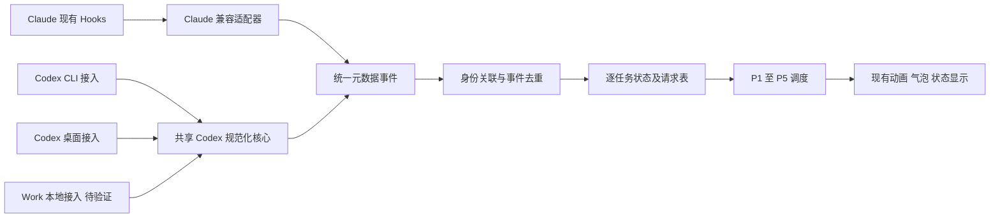

# Shion V2.0 修订版实施方案

日期：2026-10-26。状态：待用户审核；只作架构计划，未实现任何业务功能。证据依据：[阶段 0 最终验证报告](shion-v2-phase0-final.md)。现存旧材料为本地 READOUT.md 的架构修订段及 CONTROLLED-REPORT.md；未找到独立落盘的旧完整技术设计，本方案结合这些材料和本轮用户给出的完整需求重建，不声称已逐字比对缺失文档。

## 1. 正式支持目标与发布承诺

| 实际环境 | UI 品牌 | V2.0 目标 | 当前实测边界 |
| --- | --- | --- | --- |
| Claude Code 桌面 / CLI | Claude | 保留已有能力 | 本轮不重测、不更改 |
| Codex Windows 本机 CLI | ChatGPT | 正式支持目标 | 已验证基础观察，授权/结果/恢复有缺口 |
| Codex Windows 桌面 | ChatGPT | 正式支持目标 | 桌面插件本地任务部分成功；GUI 提交待测 |
| ChatGPT Work Windows 本地 | ChatGPT | 正式支持目标、分能力验收 | 未独立验证，不标为已支持 |

界面只有 Claude、ChatGPT 两个品牌；运行时类型、接入通道、版本、信任、会话、轮次仍保留在内部诊断。品牌只负责聚合显示，绝不作为任务主键。

排除普通 ChatGPT 聊天、网页版、移动端、内置 AI 聊天、Responses API、额外付费模型 API、WSL CLI。Work Cloud 仅未来扩展，不阻塞本地版本。第一版 ChatGPT 只观察和提醒，不做远程授权、暂停、终止进程或消息转发；Claude 原有授权、暂停、遥控继续保留并按来源隔离。

Codex CLI 正式纳入产品目标，并不意味着当前九项目标能力都完整通过。发布说明必须逐客户端列出完整、部分、暂不支持及待验证；Work 未验证不能默认开启。阶段 1 仍须用户另行批准。

## 2. 架构选择

采用**共享 Codex 事件解析与规范化核心，加分离的接入层和能力描述**。不复制 CLI/桌面/Work 三套状态机，也不把三者假装成完全同一种连接。

每个接入层管理发现、配置、信任引导、连接健康和能力探测。解析核心处理字段校验、事件语义、缺失 ID、版本兼容。能力按运行时版本及实际入口记录，不能由“CLI 支持”推导桌面或 Work 支持。UI 前台切换不重新安装 Hooks，不切换独占来源。

MCP 观察组件与 Shion 展示进程解耦：客户端保持一个已信任的轻量观察连接，Shion 启停只影响本地接收/展示。是否能在 Shion 中途启动时自动恢复，仍依赖真实快照；无快照只能接收后续事件，不能显示精确历史活动数。正式传输设计应在阶段 1 审核时单独确认；不能把本次逐事件文件探针直接并入正式产品。

## 3. 统一身份模型

事件最小字段：schema_version、event_type、provider_family、runtime_namespace、session_id、turn_id、可选 request_id/tool_use_id、observer_instance、transport、接收单调时间、可选源时间、可信度及受限诊断码。client_surface 为 cli/desktop/work_local/unknown；UI brand 由 provider_family 映射。进程实例、窗口绑定、连接实例均为独立属性。

任务规范键优先为 `(runtime_namespace, session_id, turn_id)`。namespace 表示经验证的运行时身份域，不是观察进程 UUID，也不是界面入口名称。无 turn_id 的 SessionStart 只创建会话，不创建活动任务。缺失关键身份的事件进入待确认记录，不能以时间接近、同文件夹、进程名或相同品牌猜测合并。

同任务多通道关联必须有可靠的显式 ID 关系；本轮桌面 threadId=session_id 是该任务的实证，不足以证明所有 Work 任务。已有规范任务可关联多个来源上下文。来源不一致时保留冲突证据，禁用精确计数。独立会话绝不因同品牌或同时间而合并。

重启时 observer_instance 改变但任务键不应必然改变；运行时身份域未知则保留待确认，不草率跨进程合并。原始 ID 仅本地使用，不进入普通用户气泡或遥测。

## 4. 状态与请求语义

TaskRecord 独立保存来源上下文、会话/轮次、当前状态、最近事件、工具集合、请求表、结果、可信度和失联原因。状态至少包括 observed_working、waiting_user_confirmed、turn_ended、interrupted、failed_confirmed、uncertain、disconnected；结果与展示状态分离。

| 证据 | 状态解释 | 禁止推断 |
| --- | --- | --- |
| UserPromptSubmit / PreToolUse | 该轮正在活动 | 不保证之后一直存活 |
| SessionStart | 会话存在 | 不等于任务开始 |
| PostToolUse | 工具返回，结束对应工具占用 | 不等于工具成功、整轮成功或全部授权解除 |
| PermissionRequest | 观察到授权检查 | 不自动进入待人工状态，不计入精确未决数 |
| Stop | 该轮结束证据，结果未知 | 不自动累计“成功任务” |
| Interrupt | 回合中断证据 | 不宣称后台进程已退出 |
| 可靠最终错误 / 可靠人工等待 | 仅适用通过验收的来源 | 工具非零退出不代替最终错误 |
| 超时 / 断连 | 待确认或失联 | 不伪造失败、成功或全局空闲 |

请求表使用 `(task_key, request_id)`，另存请求种类、是否人工、open/resolved/unknown、解除依据。只有明确人工状态且独立 ID 可靠才属于 P1 并计入“待处理授权”。否则只作受节流的“授权状态待确认”提示，不能刷屏或显示假精确数量。禁止通过读取工具参数构造授权指纹来弥补 ChatGPT 缺少 request_id 的问题。

聚合例：精确证据充足时显示“Claude：2 个活动任务；ChatGPT：3 个活动任务；待处理授权：2 个”。证据不足时显示“ChatGPT：已观察到 2 个活动任务，另有状态待确认”，或完全省略不可信的数量。单轮结束仅更新自身；其余任务继续工作。

## 5. 去重、乱序与调度

优先使用源 event_id/序号；没有时，只对已知可幂等语义使用 session/turn/event/tool 或 request 的键。无 request_id 的 PermissionRequest 不按整轮折叠成“唯一请求”，也不能简单计数。时间窗口去重仅作抑制重复展示，不能用来证明任务身份。

每轮维护终态标记及最近可信序号，延迟到达的工具事件不得复活已结束的旧轮次。事件去重与提醒去重分开：同一任务可以产生多条独立 P1，不能互相覆盖。断连和队列溢出提升 uncertainty，等待可验证快照或新事件恢复。

| 优先级 | 内容 | 仲裁 |
| --- | --- | --- |
| P1 | 明确人工授权/操作 | 独立请求排队，持续可达，不能被普通事件覆盖 |
| P2 | 最终失败、重要连接异常 | 合并同连接重复故障，保留影响任务范围 |
| P3 | 回合结束/中断 | 每轮一次；不确定结果使用中性文字 |
| P4 | 正常工作 | 同优先级优先前台来源，后台继续追踪 |
| P5 | 空闲 | 仅无可信活动且无待确认问题时使用 |

前台优先不越过更高等级提醒。前台身份绑定须验证窗口/运行时关系；不能只匹配 ChatGPT.exe。无法精确绑定时保持当前展示与公平轮转，避免凭猜测切换。设置最短展示时间与切换迟滞，高频 P4 合并；P1 保留请求队列。需要持久保存的仅是最少未决元数据，重启后标为待确认，不能直接恢复成“正在等人”。

## 6. 首装与日常自动识别

| 情况 | 预期行为与限制 |
| --- | --- |
| 首次配置 | 检查已存在配置、展示最小差异、保留 notify/第三方配置；精确合并与回滚 |
| 首次信任 | 正常入口逐定义审核；不得自动信任全部或手改信任库 |
| 已有客户端会话 | 能否热加载逐版本验收；不假设和新会话相同 |
| 新会话 | 本轮 CLI、桌面插件本地路径收到事件；正式产品仍做版本检测 |
| Shion 运行时切换 AI | 所有已配置接入保持监听；调度只切展示，无须手动选来源 |
| Shion 重启/中途启动 | 有可靠快照则重建；否则等待新事件并显示待确认 |
| 客户端重启/恢复会话 | 重建连接，保留规范身份，避免重复提醒；resume 尚待实测 |

本轮 CLI 信任可被桌面新任务使用；不能推导所有历史会话已更新。安装位置扩大到用户级属于未来单独审核项，本轮只准项目级实验。Work 本地初始入口未通过前不自动宣称检测成功。

## 7. 具体模块计划（尚未实施）

| 模块 | 拟变更 | 复用与边界 |
| --- | --- | --- |
| 新 `shion/events.py` | 纯数据统一事件、校验、能力声明 | 无 Qt、无网络、无正文 |
| 新 `shion/adapters/claude.py`、`codex.py` | 既有 Claude 转换；共享 Codex 规范化 | 接入层上下文分离，保留 Claude 控制能力 |
| 新 `shion/tasks.py` | 身份别名、逐轮记录、工具/请求表、可信度 | 独立确定性时钟，不能用全局 working 布尔替代 |
| 新 `shion/scheduler.py` | P1～P5、提醒队列、前台权重、节流 | 不把队列仲裁塞进动画代码 |
| `shion/server.py`、`bridge.py`、`controller.py` | 独立元数据接入并发到 Qt；接入调度结果 | 保留现有本机边界、鉴权思路和 Claude 路由 |
| `shion/state.py`、`activity.py` | 将多来源活动汇总接到现有行为 | Claude 兼容层逐步迁移，避免双计数 |
| `shion/foreground.py`、`winproc.py` | 经验证的窗口/运行时绑定 | ChatGPT.exe 不作为唯一身份依据 |
| `shion/bubble.py`、`panel.py`、`lines.py`、三语台词 | 双品牌、待确认、逐请求提醒 | 复用现有窗口气泡；不改角色动画 |
| `tools/hooks_config.py`、install/uninstall 入口 | 复用校验、事务、备份、合并/精确移除模式 | Claude 文件格式保持原状；Codex 配置分专用处理器 |
| `tests/` | 规范化、身份、调度、配置回退、现有 Claude 回归 | 临时 HOME，禁止真实 Claude 配置和真实 claude 命令 |

业务依赖默认不增加；是否需要 MCP 库留到正式接入方案审核，不以探针的简化实现替代生产协议实现。正式配置应记录语义级基线和精确字段哈希；本轮整体哈希不足以证明所有用户条目等价，这是需要修正的实验方法。

## 8. 分阶段顺序与放行条件

0. 完成本轮报告；补测普通桌面路径、Work 本地、授权解除、快照及跨通道关联。用户审核后决定完整能力或明确降级范围。当前停在此阶段。
1. 仅在获准后实现统一事件/任务核心及 Claude 兼容层，用脱敏元数据 fixture 验证；不同时重写 UI、配置管理与动画。
2. 接入实测通过的 Codex CLI 与桌面观察能力、配置引导、断连降级。缺失事件入口只标部分支持；首轮文字无法观察开始则明确显示限制。
3. 接入双品牌统计和 P1～P5 调度、前台优先、独立提醒。ChatGPT 授权数量必须通过门槛才显示精确值。
4. Work 本地独立通过后复用解析核心，验证同任务别名和并发；否则作为待支持入口，不阻塞已审批的本地降级版本。
5. 完整回归、真实桌面焦点/高 DPI/多显示器/打包与用户验收。版本发布、commit/push 另行授权。Work Cloud 不列入本阶段依赖链。

## 9. 测试与验收

自动测试：不同品牌同 session 字符串不碰撞；同品牌独立轮次分别计数；明确别名的双通道只计一次；无关联时待确认；乱序 Stop 不复活旧轮；工具失败不变整轮失败；Interrupt 不声称进程结束；重复事件/重复通知幂等；多个 P1 不丢失；队列饱和产生可见降级；断连后不虚构空闲；过期事件不覆盖新轮；配置已有/并发修改/清理哈希不符时停止写入。

真实客户端矩阵：CLI、桌面正常输入框、桌面插件路径、Work 本地分别测试纯文字、多轮、工具前后、人工允许/拒绝/取消、自动审查、输入等待、中断、失败、多会话、晚启动、重启、恢复与断连。每项标记入口、版本、原始元数据与预期语义，不能互相替代。Claude 与 ChatGPT 同时活动时，结束其中之一不得让另一个误为空闲；新增任务在 Shion 运行期间被接收，切换来源不要求重启 Shion。

性能候选验收预算（非本轮测量结论）：10 个并行任务、100 个元数据事件/秒持续一分钟；展示最多每 200ms 合并一次普通状态；P1 不丢失；本地事件到主线程状态更新 p95 小于 100ms；队列和去重表有明确上限，达到上限进入降级而非静默丢关键提醒。Hook 延迟必须单独量测，不能用独立探针握手耗时替代客户端开销；正式同步观察超时应比本次 2 秒更短，并验证故障不阻塞正常任务。

业务修改后按项目规范运行相关测试和必要全量回归；原生桌面焦点、点穿、高 DPI、开机启动和真实 Claude 联动必须真机验收，离屏通过不替代。zh/en/ja 同步。

## 10. 降级、风险与回退

- 无提交事件：工具到来才确认工作；纯文字结束仅提示“本轮已结束”，不补造开始时间。
- 无可靠最终结果：回合 ended、结果 unknown；不用“成功”动画文案或成功计数表达未知。
- 无人工等待/解除/请求 ID：不展示精确未决数，不在 Shion 提供 ChatGPT 授权按钮。
- 无活动快照：中途启动显示待确认；只统计已观察且可靠的活动，不把 loaded 当 active。
- 无 Work 身份关联：不合并猜测任务；Work 保持未验证，重复风险显式标记。
- 连接失败：逐来源降级，Claude 正常功能继续；错误提醒节流，不反复切动画。
- 配置风险：先保存语义哈希和精确变更清单，通过官方流程禁用后再精确删除；保留禁用信任历史并明确报告，绝不回写整个用户配置覆盖并发改动。
- 发布回退：来源开关可单独关闭 ChatGPT 接入，清空仅该来源展示；保留 Claude 路径和存档兼容。配置卸载只移除自己可证明拥有的定义，无法证明时停止并报告。

总体判断：基础观察路线已取得 CLI 与桌面本地运行时实证，可以作为后续实现依据；完整多 AI 状态、精确人工请求、Work 本地及恢复能力尚不具备发布证据。应先审批明确支持等级，再实施，而不是为追求功能清单读取私有会话日志或使用不稳定内部接口。
